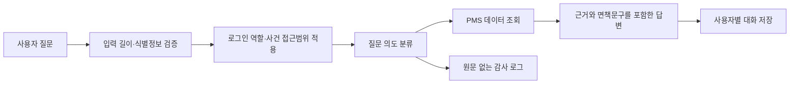
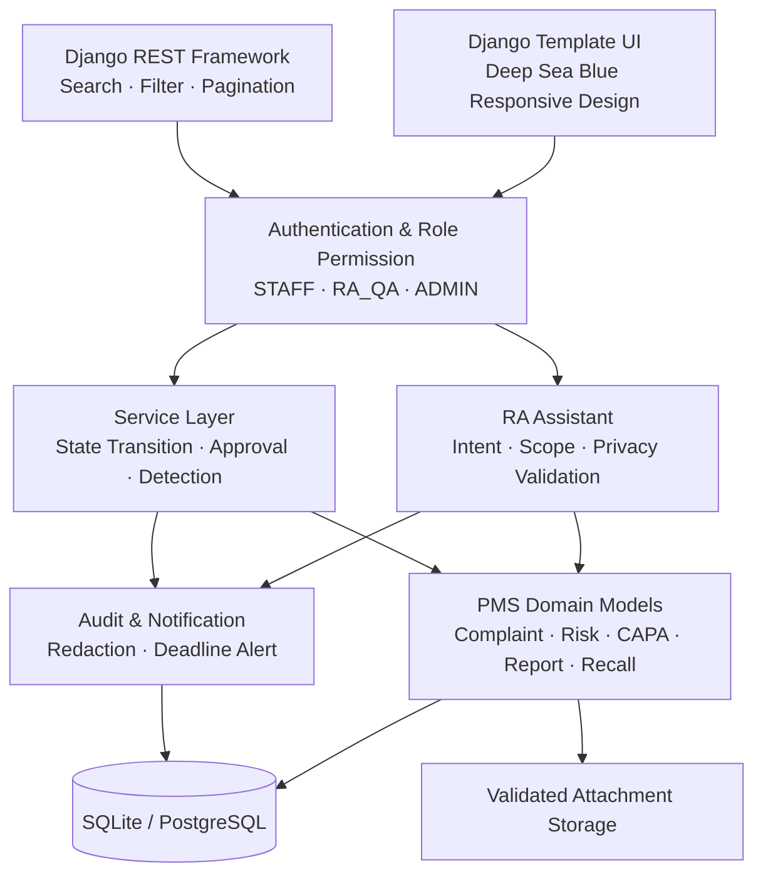
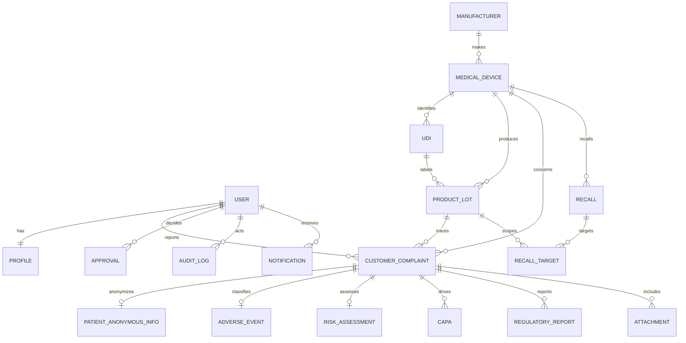

# MedWatch PMS · 의료기기 PMS·리콜 관리 시스템

이번 개정은 규정 관리의 **개정 영향 분석**(`/rules/impacts/`), 후보별 검토 업무·기한 비교·명시적 재적용, 내용 해시 기반 승인 유효성·재승인, PostgreSQL 동시성 CI를 추가합니다. 설치 시 `python manage.py migrate`로 0008을 적용하세요. 사용 순서, 레거시 승인 처리, 검증·격리 시연 명령과 구현 한계는 [개정 영향·승인 안내](IMPACT_APPROVAL_GUIDE.md)를 따릅니다. 아래 과거 버전의 테스트 개수는 당시 기록이며 현재 결과는 실제 테스트 실행으로 확인합니다.

의료기기 출시 후 고객 불만, 이상사례, 위험평가, CAPA, 규제보고, 리콜과 회수율을 하나의 추적 가능한 흐름으로 관리하는 **취업 포트폴리오용 Django 5 데모**입니다. 실제 식약처 규정 준수, 법정 보고 기한 또는 의료 판단을 자동 보장하는 시스템이 아닙니다.

> **한 줄 소개**: 흩어진 시판 후 안전관리 업무를 역할 기반 상태 머신과 감사 가능한 승인 흐름으로 연결한 의료기기 RA·QA 포트폴리오 프로젝트

## 해외 인허가와 시장별 PMS

왼쪽 **해외 인허가** 메뉴(`/markets/`)에서 시장별 등록 상태, 90일 내 만료 예정 등록, 검토 대기 사건을 확인합니다. **제품 상세 → 해외 인허가**에서는 제품별 시장 등록을, **사건 상세 → 사건의 시장별 보고 판단**에서는 시장별 담당자, RA 판단, 기한, 검토 상태를 관리합니다. 한 사건을 여러 시장에 연결할 수 있으며, 제품의 등록 상태는 사건의 보고 상태에 영향을 주지 않습니다.

- 지원 시장: 한국, 미국, 독일, 프랑스, 스페인, 이탈리아. EU는 공동 근거의 관할이며 판매 시장 목록과 구분됩니다. 독일·프랑스·스페인·이탈리아 등록에서 국가 관할기관과 제출 언어를 기록하고, EU 공동 근거와 국가별 근거의 적용 관계를 확인합니다. 근거 개정, 충돌 또는 범위 미확정 시 재검토합니다.
- 지원 UI: 한국어, 영어, 독일어, 프랑스어, 스페인어, 이탈리아어. 계정 메뉴에서 언어를 저장하면 공통 메뉴, 해외 인허가 대시보드, 시장 등록, 시장별 사건 상세, 규칙 비교, 근거, 오류·빈 상태와 인쇄 화면에 적용됩니다. 사건 서술·문서·사용자 입력은 입력된 언어를 유지합니다. 카탈로그의 번역 누락은 영어로 표시하고 `pms.i18n` 로그에 로캘·키를 기록합니다. [번역 범위와 누락 목록](docs/market-localization.md)을 참조하세요.
- 권한: 기존 ADMIN과 전역 RA/QA는 전체 시장을 관리합니다. 해외 담당자는 RA/QA 역할에 더해 Django 관리자 **Market accesses**에 허용 국가 목록(예: `["US","DE","FR"]`)을 부여합니다. 시장 범위가 지정된 계정은 전용 화면에서만 허용 시장·사건·근거에 접근합니다. 철회는 레코드를 남겨 두고 목록을 `[]`로 저장합니다. 직원의 기존 사건 조회 범위는 유지됩니다.
- 규칙: 기존 **보고 규칙·근거**의 규칙 작성·승인 절차를 사용합니다. 판매 시장의 표준 관할 코드를 사용하고, 적용 범위·시행 기간, 공식 원문 URL·문서 버전·조항, 원문 검토 일시·검토자를 기록하세요. 시장 판단은 동일 시장, 제품 범위, 예시 여부, 사건 발생 업무일에 맞는 승인본만 검토합니다. 후보 없음, 후보 중복, 입력 누락, 미검증 원문 또는 EU 범위 문제는 **RA 확인 필요**로 보류합니다. 날짜만 아는 경우 업무 날짜를 보존하며, 시간 단위 규칙에는 오프셋이 포함된 원본 시각이 필요합니다. 규칙에서 정한 시간대로 계산하므로 UI 언어 변경이 기한에 영향을 주지 않습니다.
- 버전과 출력: **규칙 버전 비교**는 같은 시장·같은 계열의 두 버전을 같은 사건에 적용해 판단, 기산점, 기한, 근거를 나란히 표시합니다. 비교는 미리보기이며 사건·스냅샷에 쓰지 않습니다. 시장별 자동 판단은 추가 전용으로 저장합니다. 원문과 번역에는 별도 버전·언어·검토 상태가 있으며, 최신 원문이 등록되면 이전 원문의 번역은 재검토 표시가 붙습니다. **보고서 출력 언어 → 내부 검토용 보고서 초안**을 선택해 인쇄하거나 브라우저에서 PDF로 저장할 수 있습니다. 기존 **보고서 → 인쇄**에서도 시장과 출력 언어를 선택할 수 있습니다. 보존용 서버 PDF·증빙 묶음은 기존 형식으로 유지합니다.
- 데이터 이전: `0028`–`0030`을 적용합니다. 기존 사건과 규칙, 연결, 기한, 승인·적용 스냅샷을 수정하지 않습니다. 확정 가능한 시장은 과거 규칙 적용 기록이나 제품 규제 프로필에 근거해 연결합니다. 근거가 없거나 EU 범위만 기록된 경우 **시장 미지정**으로 표시합니다. 기존 미국·EU 신청 및 심사 이력은 제품 탭에서 기존 업무로 이동해 확인할 수 있습니다.

### PowerShell 로컬 실행

Python 3.12가 설치된 저장소 루트에서 실행합니다. 운영 DB가 아닌 별도 예시 DB를 사용합니다.

```powershell
python -m venv .venv
$python = ".\.venv\Scripts\python.exe"
& $python -m pip install -r requirements.txt
$env:SQLITE_PATH = Join-Path $PWD "db.sqlite3"
$env:PRIVATE_MEDIA_ROOT = Join-Path $PWD "private_media"
$env:DEMO_PASSWORD = "Local-Example-Only-2026!"
$env:PDF_KOREAN_FONT = Join-Path $env:WINDIR "Fonts\malgun.ttf"
$env:DEBUG = "True"
& $python manage.py migrate --noinput
& $python manage.py seed_market_demo
& $python manage.py runserver 127.0.0.1:8000
```

DB 경로는 새 로컬 작업 복사본 기준입니다. 기존 데이터가 있다면 `SQLITE_PATH`에 별도의 새 파일을 지정하세요. 데모 비밀번호는 두 데모 계정에만 사용합니다.

1. **한국 본사 RA — `example-hq`:** [해외 인허가](http://127.0.0.1:8000/markets/)에서 예시 Pulse Monitor 제품과 신호 손실 사건을 엽니다. 한국 등록의 만료 예정일과 미국의 검토 중 상태를 확인합니다. 한국어 UI에서 독일 사건을 열어 **EU 공동**과 **국가별 추가 요건**을 열고, 독일어 원문과 한국어 검토 번역을 나란히 확인합니다. 한국 시장에서 v1과 v2를 비교합니다.
2. **해외 RA — `example-overseas`:** 프랑스어 화면에서 미국 제품 등록을 확인하고, 독일 사건에서 독일어 또는 영어로 바꿔도 시장과 기한이 동일한지 확인합니다. 독일 시장의 v1·v2를 비교합니다. 프랑스 시장의 EU 범위 충돌 및 미검토 번역 표시를 확인합니다. 한국 시장 URL에 직접 접근하면 거부됩니다.
3. **출력 확인:** 스페인어·이탈리아어로 공통 메뉴, 등록, 사건, 비교 화면을 확인합니다. 독일 사건의 보고서 출력 언어를 스페인어 또는 이탈리아어로 선택해 내부 검토용 초안을 엽니다. UI 언어와 출력 언어는 따로 저장됩니다.

데모 제품·사건·근거·규칙은 **예시**입니다. 한국·미국·독일의 계산 결과는 가상의 값이며, 프랑스는 공동 근거와 국가별 요건 충돌로 보류됩니다. 실제 운영 전 여섯 시장 모두 공식 원문, 제품별 관할과 적용 범위, 보고 조건·기산점·기한, 휴일 근거, 관할기관과 제출 언어를 RA가 확인해야 합니다. 독일·프랑스·스페인·이탈리아는 EU 공동 요건과 국가별 추가 요건의 관계도 확인해야 합니다. 스페인·이탈리아에는 데모 사건을 생성하지 않습니다.

### 검증 명령

```powershell
& $python manage.py test --noinput
& $python manage.py test pms.test_market_workspace --noinput
& $python manage.py makemigrations --check --dry-run
& $python -m compileall -q pms config scripts
& $python manage.py collectstatic --noinput
& $python manage.py check
```


## 독일 시장 규칙 비교와 검토 이력

마이그레이션 `0031`은 비교 실행, 사건별 결과, 검토 이벤트 테이블을 추가합니다. 이전 승인본과 같은 계열의 개정 초안을 사건에 대조하면 결과를 저장하고 결과 페이지로 이동합니다. 판단·기산일·기한, 규칙과 휴일, 원문 인용과 시장 근거의 문서·번역 버전, 실행자·실행 시각·계산 엔진이 실행 당시 값으로 남습니다. 운영 판단과 비교 결과는 시장별 사건 화면에서 각각 열 수 있습니다.

결과 표는 보고 판단 변경, 기한 앞당김, 기한 늦어짐, 추가 확인 필요로 좁혀 볼 수 있습니다. 검토 완료 여부는 사건별 비교 결과에서 변경하며 메모와 상태 변경은 별도 이벤트로 저장합니다. 검토자 간 덮어쓰기를 막기 위해 상세 화면을 열었을 때의 마지막 이벤트 ID가 필요합니다. 감사 로그에는 실행자, 실행 및 상태 변경 정보를 기록합니다.

**해외 인허가 → 사건 일괄 검증 → 저장된 결과**에서 변경 유형을 선택한 뒤 **CSV 다운로드**를 누릅니다. 전체 보기에서는 실행의 모든 결과를, 일치하는 행이 없으면 열 이름만 UTF-8 BOM CSV로 받습니다. 파일에는 실행 ID·일시, 시장, 결과·사건 ID, 예시 여부, 양쪽 규칙 ID·버전과 저장된 판단·기산일·기한, 기한 차이(개정안 − 기준본), 변경 유형, 최신 검토 상태가 포함됩니다. 열 이름과 상태 코드는 화면 언어와 무관하며 여러 변경 코드는 `|`로 구분됩니다. 검토 메모와 사건·근거 문서 내용은 제외됩니다.

검토 이력은 실행자와 권한 있는 관리자가 열 수 있습니다. 시장과 사건·규칙 접근 권한을 다시 검사합니다. JSON API `GET /markets/api/comparison-results/<id>/`로 같은 스냅샷과 검토 이력을 읽습니다. 로그인 세션과 CSRF 토큰을 포함한 JSON `POST`에 `note`(1~2,000자), `complete`(불리언), `previous`(GET 응답의 `revision`)를 보내면 같은 권한 검사와 이벤트 기록을 사용합니다.

마이그레이션 `0032`를 적용하면 **비교 결과 상세 → 검토 결론**에서 영향 없음, 후속 조치 필요, 추가 근거 필요 중 하나를 선택하고 검토 사유와 당시 원문·번역본을 기록할 수 있습니다. **후속 조치 필요**를 저장하면 **RA 검토 업무 등록**에서 해당 사건에 업무를 연결할 수 있고, 이후 같은 상세에서 다시 엽니다. 정정할 때는 정정 사유를 입력합니다. 비교 검토 이력에는 이전 결론과 메모, 문서 버전, 작성자가 함께 남습니다.

API로 결론을 기록할 때는 기존 POST 필드에 `conclusion`(`no_impact`, `follow_up_required`, `more_evidence_required`), 선택한 `evidence` 키 배열(GET 응답의 `evidence_options`), 기존 결론을 정정할 경우 `correction_reason`을 보냅니다. 다른 검토자가 먼저 저장하면 `409`와 최신 `revision` 및 이력이 반환됩니다.

새 로컬 예시 DB로 실행합니다.

```powershell
python -m venv .venv
$py = ".\.venv\Scripts\python.exe"
& $py -m pip install -r requirements.txt
$env:SQLITE_PATH = Join-Path $PWD "db.market-review-demo.sqlite3"
$env:PRIVATE_MEDIA_ROOT = Join-Path $PWD "private_media"
$env:DEMO_PASSWORD = "Local-Example-Only-2026!"
$env:DEBUG = "True"
& $py manage.py migrate --noinput
& $py manage.py seed_market_review_demo
& $py manage.py runserver 127.0.0.1:8001
```

1. `example-hq`와 위 예시 비밀번호로 [독일 일괄 검증](http://127.0.0.1:8001/markets/batch/DE/)에 로그인합니다. 한국어에서 `DE vigilance review` 계열의 승인본 v1과 초안 v2, `Earlier deadline`과 `Missing trigger` 두 예시 사건을 고릅니다.
2. **일괄 검증 실행**을 누릅니다. 등록 휴일 10월 6일을 건너뛰어 첫 사건 기한은 **2026-10-09 → 2026-10-07**로 2일 앞당겨집니다. 둘째 사건은 기산일 누락으로 두 버전 모두 보류됩니다.
3. 첫 결과 **비교 결과 상세**를 열어 `EX_DE_REVIEW` 조건, 인지 기산일, 영업일·휴일 설정, 독일 시장 근거 v2와 한국어 번역 검토 상태를 확인합니다.
4. 상단 언어를 **Deutsch**로 저장합니다. 같은 결과 ID, 규칙 버전, 기한이 유지됩니다. **Vergleichsauswahl erneut öffnen**에서 선택했던 사건과 규칙을 다시 볼 수 있습니다.
5. **Prüfnotiz**에 예시 메모를 입력하고 **Vergleich geprüft**를 체크해 저장합니다. **Prüfverlauf des Vergleichs**에서 결과를 다시 엽니다.
6. 상세 상단의 **Snapshot der operativen Entscheidung**을 열어 기존 승인본의 10월 9일 기한을 확인합니다. 계산 결과와 검토 메모는 비교 기록에만 남습니다.

C++ 모듈은 선택 사항입니다. 모듈이 로드돼도 독일 예시의 `Europe/Berlin` 기한 계산은 기존 Python으로 대체되고 그 사유가 저장됩니다. C++에서 지원하는 결과는 Python과 대조하며 값이 다르면 양쪽 값과 검토 필요 상태를 기록합니다. CLI와 WASM 데모의 기존 비교 기능은 그대로 사용할 수 있습니다.

```powershell
& $py manage.py test pms.test_market_review pms.test_market_batch pms.test_market_workspace pms.test_regulatory --noinput
```


## 해외 시장 보고 규칙 일괄 검증

**해외 인허가 → 사건 일괄 검증**(`/markets/batch/`) 또는 **시장별 사건 → 규칙 버전 비교 → 사건 일괄 검증**에서 시작합니다. 허용된 시장, 같은 계열의 규칙 두 버전, 해당 시장에서 조회할 수 있는 사건 최대 100건을 선택합니다. 같은 버전의 기술 검증은 CLI 또는 WASM 데모에서 실행할 수 있습니다. 오래된 사건은 숫자 ID를 직접 입력할 수 있습니다. 결과 표시는 기존 앱의 6개 UI 로캘을 따르며, 계산은 로캘과 무관합니다.

Django는 기존 Python 비교를 기준으로 계산합니다. 선택 모듈 `pms_rule_batch`가 있으면 지원하는 각 버전을 C++로도 계산합니다. 화면에서 C++ 일치 여부, Python으로 대체한 사유, 불일치 필드와 양쪽 값을 확인할 수 있습니다. 권한, 근거 접근, 규칙의 적용 전제는 Django에서 검사합니다. 실행 감사에는 실행자, 시장, 규칙 버전, 엔진, 건수와 상태가 남습니다. 결과는 읽기 전용 검증이며, 사건·기한·스냅샷·규칙 승인 상태와 기존 RA 작업 큐를 유지합니다. 기존 큐는 검토 업무를 기록하며 이 비교는 최대 100건의 동기 요청입니다.

### C++17 지원 범위와 JSON v1

`native/rule_batch`의 C++ 코어를 CLI, pybind11, Emscripten WebAssembly에서 공유합니다. 운영 판단과 원문 근거는 기존 Python 앱에서 관리합니다. C++ 범위는 날짜만 주어진 기산점, 달력일과 영업일, 시작일 포함/제외, 0–3660일, 초 단위 현지 마감 시각, 토·일과 확인된 휴일입니다. 영업일은 기산일부터 계산이 진행되는 모든 날짜가 명시된 확인 범위 안에 있어야 합니다. 시간대는 UTC, Etc/UTC, 2000년 이후 Asia/Seoul을 지원합니다. 시각·UTC 오프셋이 있는 입력, 경과 시간(HOURS), DST가 있는 시간대, 다른 주말 패턴은 C++ 결과에 `unsupported`를 표시하며 앱에서 Python 기준 계산을 표시합니다. 사건 조건은 `complaint_type`, `risk_level`, `serious`의 동등 비교입니다. 누락과 거짓은 구분합니다.

[실행 가능한 JSON 예시](native/rule_batch/fixtures/cli-example.json)를 참조하세요. 입력은 UTF-8이며 한 배치에 최대 16 MiB, 고유 사건 ID 1–10,000건입니다. 각 객체의 키는 다음과 같습니다.

| 객체 | 필드 |
| --- | --- |
| 배치 | `schema_version: 1`, `market`(KR, US, DE, FR, ES, IT), `rules`(이전/개정 순서 2개), `cases` |
| 규칙 | `id` 문자열, 양의 정수 `version`, `market`, `device` 문자열 또는 null, `example` 불리언, `basis`(OCCURRED, REPORTED, AWARE, CUSTOM 또는 null), `conditions`, `unit`, `day_type`, `days`, `include_start`, `timezone`, `deadline_time`(HH:MM:SS 또는 null), `calendar` |
| 달력 | `weekend`(월요일 0부터 일요일 6), `holidays`(중복 없는 YYYY-MM-DD 목록), `verified_from`, `verified_until`, `checked_on`(날짜 또는 null). 확인일은 입력 측에서 검증한 값입니다. |
| 사건 | `id` 문자열, `device`, `example`, `facts`(값이 없으면 null 또는 생략), `bases`(기산점별 YYYY-MM-DD, 초가 포함된 ISO 8601 오프셋 일시 또는 null), 선택 `business_dates`(기록된 업무 날짜), 선택 `holds`(두 버전의 원문/적용 범위 사전 보류 사유) |

출력 `{schema_version, market, results}`의 각 행은 `case_id`, `baseline`, `proposed`, `changes`, `delta_days`입니다. 버전별 결과에 `decision`, `reason`, `basis_date`, `due_date`, `due_at`(ISO 8601 오프셋), `rule_id`, `version`이 있습니다. 판단은 `REPORT`, `NO_MATCH`, `HOLD`, `unsupported` 중 하나입니다. 기한 차이는 개정안 날짜 − 이전 날짜이며 둘 다 계산된 경우에만 숫자입니다. `changes`에는 판단 변경, 기한 앞당김/늦어짐, 마감 시각 변경, 기한 추가/제거, 추가 확인 필요, 변경 없음이 해당하는 조합으로 들어갑니다.

CLI는 `pms-rule-batch [--timings] [FILE|-]`입니다. 경로를 생략하거나 `-`를 주면 표준 입력을 읽습니다. 성공 결과는 표준 출력에 JSON 한 줄로 나옵니다. `--timings`를 쓰면 성공 시 내부 단계 시간(ms)을 표준 오류에 JSON 한 줄로 별도 출력합니다. 종료 코드 0에는 사건별 보류·미지원이 포함될 수 있습니다. 2는 잘못된 입력, 3은 입출력 오류, 4는 엔진 오류입니다. 오류는 표준 오류에 `{"schema_version":1,"error":{"code":"invalid_input|io_error|internal_error","message":"..."}}`로 출력합니다. Python 모듈의 `run_json(str) -> str`은 잘못된 입력에 `ValueError`를 발생시킵니다.

### Windows PowerShell

Visual Studio C++ Build Tools의 **Developer PowerShell**에서 저장소 루트로 이동합니다. 아래 명령은 CMake/Ninja와 Python 개발 헤더가 있는 CPython 3.12 x64를 사용합니다.

```powershell
python -m venv .venv
$py = (Resolve-Path .venv/Scripts/python.exe).Path
& $py -m pip install -r requirements.txt cmake ninja pybind11
$env:Path = "$(Split-Path $py);$env:Path"
$bind = & $py -m pybind11 --cmakedir
cmake -S native/rule_batch -B build-rule-batch -G Ninja -DCMAKE_BUILD_TYPE=Release -DPMS_PYTHON=ON "-DPython_EXECUTABLE=$py" "-Dpybind11_DIR=$bind"
cmake --build build-rule-batch
$env:PYTHONPATH = (Resolve-Path build-rule-batch).Path
& .\build-rule-batch\pms-rule-batch.exe native/rule_batch/fixtures/cli-example.json
Get-Content native/rule_batch/fixtures/cli-example.json -Raw | & .\build-rule-batch\pms-rule-batch.exe -
& $py manage.py test pms.test_market_batch pms.test_regulatory pms.test_market_workspace --noinput
```

### Linux

C++17 컴파일러와 Python 개발 헤더(예를 들어 배포판의 `build-essential`, `python3-dev`, `python3-venv`)를 설치합니다.

```bash
python3 -m venv .venv
source .venv/bin/activate
python -m pip install -r requirements.txt cmake ninja pybind11
cmake -S native/rule_batch -B build-rule-batch -G Ninja -DCMAKE_BUILD_TYPE=Release -DPMS_PYTHON=ON \
  -DPython_EXECUTABLE="$(command -v python)" -Dpybind11_DIR="$(python -m pybind11 --cmakedir)"
cmake --build build-rule-batch
export PYTHONPATH="$PWD/build-rule-batch"
./build-rule-batch/pms-rule-batch native/rule_batch/fixtures/cli-example.json
python manage.py test pms.test_market_batch pms.test_regulatory pms.test_market_workspace --noinput
```

CLI만 필요하면 `PMS_PYTHON`을 생략하세요. CMake는 설치된 nlohmann/json을 찾거나, 처음 구성할 때 SHA-256이 고정된 소스를 내려받습니다. 로컬 소스가 있다면 `-DFETCHCONTENT_SOURCE_DIR_NLOHMANN_JSON=/path/to/json`으로 지정할 수 있습니다.

### WebAssembly 예시

Windows에서는 저장소 루트에서 다음을 실행합니다.

```powershell
git clone https://github.com/emscripten-core/emsdk.git ../emsdk
$sdk = (Resolve-Path ../emsdk).Path
& $py "$sdk/emsdk.py" install 4.0.23
& $py "$sdk/emsdk.py" activate 4.0.23
$env:EM_CONFIG = "$sdk/.emscripten"
$env:Path = "$sdk/upstream/emscripten;$(Split-Path $py);$env:Path"
cmake -S native/rule_batch -B build-rule-wasm -G Ninja -DCMAKE_BUILD_TYPE=Release "-DCMAKE_TOOLCHAIN_FILE=$sdk/upstream/emscripten/cmake/Modules/Platform/Emscripten.cmake"
cmake --build build-rule-wasm
cmake --install build-rule-wasm --prefix "$PWD/static/rule-batch"
& $py -m http.server 8765 --bind 127.0.0.1 --directory static/rule-batch
```

Linux에서는 저장소 루트에서 다음을 실행합니다.

```bash
git clone https://github.com/emscripten-core/emsdk.git ../emsdk
../emsdk/emsdk install 4.0.23
../emsdk/emsdk activate 4.0.23
source ../emsdk/emsdk_env.sh
emcmake cmake -S native/rule_batch -B build-rule-wasm -G Ninja -DCMAKE_BUILD_TYPE=Release
cmake --build build-rule-wasm
cmake --install build-rule-wasm --prefix "$PWD/static/rule-batch"
python -m http.server 8765 --bind 127.0.0.1 --directory static/rule-batch
```

[로컬 데모](http://127.0.0.1:8765/index.html)를 열고 **오프라인 준비 완료**가 뜨면 오프라인으로 전환한 뒤 페이지를 다시 열어 시장과 규칙을 변경해 보세요. Django에서도 자산을 설치한 후 **사건 일괄 검증 → 오프라인 규칙 비교 데모**에서 열 수 있습니다. WASM 바이트는 `engine.js`에 내장됩니다. 서비스 워커는 데모 자산만 저장합니다. 예시 사건과 예시 규칙만 선택할 수 있으며, 계산 시 네트워크 호출이 없습니다. 자산을 다시 배포해 캐시를 갱신할 때는 데모 서비스 워커의 캐시 버전도 올립니다. [공식 Emscripten 설치 문서](https://emscripten.org/docs/getting_started/downloads.html)

### 일치성·오프라인·벤치마크 재현

PowerShell 예시입니다. Linux에서는 `$py`를 `python`으로, CLI 파일 이름을 `build-rule-batch/pms-rule-batch`로 바꿉니다. Node.js 22 이상과 Chromium 브라우저가 필요합니다. 앞에서 시작한 로컬 데모 서버를 실행한 상태에서 브라우저 검사를 실행합니다.

```powershell
& $py native/rule_batch/verify.py --cli build-rule-batch/pms-rule-batch.exe --wasm build-rule-wasm/engine.js
node native/rule_batch/browser_check.cjs "C:/Program Files/Google/Chrome/Application/chrome.exe" http://127.0.0.1:8765/index.html
& $py native/rule_batch/benchmark.py --cli build-rule-batch/pms-rule-batch.exe --repeats 7
```

벤치마크는 같은 가상 사건을 두 버전에 적용합니다. 계산 시간은 입력 준비 후부터 결과 객체가 생성될 때까지입니다. 전체 시간은 JSON 인코딩·파싱·결과 변환을 포함하며 CLI에는 프로세스 시작 및 파이프 입출력도 포함합니다. 앱 요청의 인증, ORM, 근거 조회, 감사 기록 시간은 별도입니다.

실측 환경은 Windows 11 x64, Intel Core i5-1130G7, CPython 3.12.14, LLVM-MinGW Clang 23.1.5입니다. C++ 네이티브는 `-O3`, WASM은 Emscripten 4.0.23 `-O3`로 빌드했습니다. 엔진당 워밍업 1회와 측정 7회의 중앙값입니다.

| 사건 수 | Python 계산 / 전체 ms | C++ CLI 계산 / 전체 ms | pybind11 계산 / 전체 ms |
| ---: | ---: | ---: | ---: |
| 100 | 2.939 / 3.918 | 1.256 / 12.448 | 0.963 / 2.620 |
| 1,000 | 30.398 / 39.226 | 11.295 / 46.178 | 10.348 / 28.060 |
| 10,000 | 370.696 / 471.822 | 111.533 / 596.606 | 114.877 / 536.485 |

Python 기준, CLI, pybind11, WASM의 41개 예시 배치(사건 비교 210건)가 일치했습니다. pybind11을 로드한 Django 규칙·시장 테스트 56개가 통과했습니다. 모듈을 제거한 재실행에서는 선택 모듈 테스트 한 건을 건너뛰었고 나머지 55개가 통과했습니다. 내장 브라우저에서 로컬 서버를 중지한 뒤 서비스 워커 캐시로 다시 열어 시장과 개정안을 바꿨습니다. Resource Timing으로 관찰한 추가 리소스 요청과 외부 출처 요청은 모두 0건이었습니다.

이 Windows 작업 환경의 CMake는 C++ 컴파일러 탐색에서 `0xC0000409`로 종료돼 실제 검증 바이너리는 동일 소스를 Clang 및 Emscripten 드라이버로 직접 빌드했습니다. 자동 Chromium/CDP 실행은 Windows IPC 권한 오류가 있어 내장 브라우저로 오프라인 동작을 확인했습니다. 표준 CMake 구성과 Linux 빌드, 자동 Chromium 실행은 위 명령으로 재현할 수 있습니다.

## 프로젝트 요약

| 항목 | 내용 |
|---|---|
| 프로젝트 유형 | 의료기기 PMS(Post-Market Surveillance)·리콜 관리 웹 서비스 |
| 주요 사용자 | 고객 대응 STAFF, RA_QA 검토자, ADMIN 승인자 |
| 핵심 문제 | 불만부터 리콜까지 분리된 업무와 판단 근거를 하나의 사건 이력으로 추적 |
| 핵심 가치 | 서버 권한, 순차 상태 전이, 위험평가, CAPA·규제보고·리콜 연결, 승인 스냅샷, 감사 로그 |
| 백엔드 | Python 3.12, Django 5, Django REST Framework |
| 데이터베이스 | SQLite 개발환경, PostgreSQL 운영환경 |
| 프런트엔드 | Django Template, 반응형 자체 CSS, Chart.js |
| 배포 기반 | Docker, Docker Compose, GitHub Actions |
| 자동화 검증 | Django 테스트 113개 (SQLite에서 PostgreSQL 전용 4개 제외), system check, 마이그레이션 검사 |

## 뇌파분석 소프트웨어 버전 추적

마이그레이션은 `python manage.py migrate`로 적용합니다. 기존 제품은 미분류로 유지되며 기존 불만의 접수 버전은 비워 둡니다. 제품 등록 화면에서 유형을 **소프트웨어**로 지정합니다. 기존 제품의 유형은 Django 관리자 제품 화면에서도 지정할 수 있습니다. 제품 상세에서 RA/QA 또는 관리자가 출시일과 버전을 등록합니다.

격리 SQLite DB에서 `DEMO_PASSWORD`를 설정한 뒤 `python manage.py seed_demo`를 실행합니다. 명령에 표시되는 소프트웨어 사건 주소 중 **완료** 건에는 초기 승인과 재승인 이력이 있고, **실습** 건은 접수 상태입니다. 두 사건 모두 가상 데이터입니다.

1. **불만 접수**에서 뇌파분석 소프트웨어 제품과 데모 UDI를 고르고 `v1.2.0`을 선택합니다. 버전을 모르면 비워 둡니다. 불만 목록에서 제품, 접수 버전, 버전 미확인 여부를 확인합니다.
2. **사건 상세**에서 RA/QA로 접수 버전, 영향 버전 및 근거를 확인합니다. 실습에서는 위험평가와 CAPA를 등록하고, 리콜·규제보고 판단 및 근거를 기존 검토 영역에 기록합니다.
3. **CAPA 상세 → 평가 추가**에서 수정 릴리스 `v1.2.1`, 조치 결과, 기준 및 판정을 기록합니다. 사건에 첨부한 증빙 중 검사 통과 파일을 선택할 수 있습니다. 데모의 판정과 시험 결과는 가상이며 첨부 파일 연결에는 기존 검사 설정이 필요합니다.
4. **관리자 승인**을 요청하고 승인합니다. 조치 완료 후 영향 범위를 변경해 종료가 차단되는 것을 확인합니다. 변경 사유를 남겨 재승인을 요청한 뒤 관리자로 승인하고 종료합니다.
5. **규제보고 인쇄**에서 현재 버전 및 검증 요약을 확인합니다. **PDF·증빙 묶음**에서 생성 시점의 내용을 보존할 수 있습니다. 서버 PDF 생성에는 기존 `PDF_KOREAN_FONT` 설정이 필요합니다.

## 해외 의료기기 인허가 (미국·EU)

제품 상세의 **해외 인허가 → 기존 미국·EU 신청 업무**로 이동하거나 `/foreign/`을 엽니다. 제품 상세의 **시판 후 규제보고** 탭은 해당 제품의 기존 PMS 규제보고로 연결됩니다. 해외 인허가의 제출·결과 등록은 내부 기록 작업입니다.

1. **RA 업무 추적 → 제품 규제 프로필**에서 해당 제품과 조직의 프로필을 등록합니다. 관할에는 `US` 또는 `EU`를 입력합니다. 시연 건에는 시연용 프로필을 사용합니다.
2. **해외 인허가 → 신청 건 등록**에서 해당 프로필과 시장을 선택하고 모델 또는 릴리스, 사용목적, 신규·변경·갱신 유형, 담당자와 근거를 기록합니다. 후속 신청은 이전 건을 연결할 수 있습니다. 검토 중인 분류와 경로는 공란이면 미확정으로 표시합니다.
3. **시장별 문서 체크리스트**에서 적용 여부와 근거, 준비 상태, 버전 및 증빙을 입력합니다. 항목은 내부 준비용 예시입니다. 적용 문서에는 검사 통과 증빙이 필요합니다.
4. **내부 검토 요청 → 관리자 내부 승인 → 제출 이력 기록** 순서로 진행합니다. 신청 작성자와 승인자를 분리하며, 조직에서 지정한 RA 승인 사전 교육 조건을 적용합니다. 제출일, 참조번호와 검사 통과 제출 증빙을 등록합니다. 문서나 제출 범위가 바뀌면 재검토를 요청합니다. 제출 당시 버전은 제출 이력에 보존됩니다.
5. **보완 요청과 회신**에서 요청별 담당자와 기한 근거를 입력합니다. 연결 업무에 기한이 전달됩니다. **외부 심사 결과**에는 발행 주체, 결과일, 문서 번호, 증빙과 해당 시 유효기간을 입력합니다.

격리 환경에서 `SQLITE_PATH`, `PRIVATE_MEDIA_ROOT`, `DEMO_PASSWORD`를 설정합니다. 아래 명령이 가상의 뇌파분석 소프트웨어 미국·EU 신청 주소를 출력합니다. 뇌파계 예시 제품과 시장 프로필도 생성합니다.

```powershell
python manage.py migrate
python manage.py seed_demo
python manage.py seed_foreign_demo
```

전체 시드에는 기존 증빙 검사 설정인 `ANTIVIRUS_COMMAND`가 필요합니다. 검사기 없는 환경에서는 `python manage.py seed_foreign_demo --prepare-only`로 준비 단계까지 생성할 수 있습니다. 전체 시드의 미국 건에는 가상 내부 승인, 가상 제출 기록, 회신한 보완 요청과 회신 대기 요청이 포함됩니다. EU 건에는 분류·경로 검토와 기술문서 준비가 표시됩니다.

## 빠른 데모 시나리오

면접이나 포트폴리오 시연에서는 다음 순서로 약 3분 안에 핵심 기능을 보여줄 수 있습니다.

1. `staff`로 로그인해 제품·UDI·LOT를 지정한 고객 불만을 접수합니다.
2. STAFF 계정에서는 자신이 등록한 사건만 보이는 것을 확인합니다.
3. `raqa`로 로그인해 사건 상세 통합 워크스페이스를 엽니다.
4. 심각도와 발생 가능성을 입력해 위험점수와 등급이 자동 계산되는 것을 확인합니다.
5. HIGH 이상 사건에서 CAPA 없이 다음 단계로 갈 수 없는 서버 검증을 확인합니다.
6. 규제보고 판단 체크리스트와 조사 결과를 저장합니다.
7. 필요 시 리콜 검토안을 만들고 LOT·시리얼 대상과 회수율을 확인합니다.
8. 관리자 승인 단계에서 사건 버전과 관련 자료가 스냅샷으로 고정되는 것을 확인합니다.
9. `admin`으로 승인 또는 사유를 포함한 반려를 처리합니다.
10. 감사 로그와 포트폴리오용 규제보고서·리콜 종료 보고서를 인쇄합니다.

## RA 전용 챗봇

로그인 후 왼쪽 사이드바의 **RA 도우미** 메뉴 또는 모든 업무 화면의 **RA 업무·챗봇** 버튼으로 실행합니다. 직접 주소는 `/assistant/`입니다. 이 기능은 외부 생성형 AI API를 호출하지 않는 로컬 규칙 기반 도우미로, 데모 데이터와 현재 사용자의 접근 권한 범위 안에서만 답변합니다.

### 왼쪽 업무 사이드바

화면 폭 480px 이상에서는 기존 상단 메뉴를 왼쪽 고정 사이드바로 표시합니다. 대시보드, 불만, 이상사례, 제품, UDI·LOT, CAPA, 리콜, 보고서, RA 도우미와 알림을 한 세로 메뉴에서 사용할 수 있으며, ADMIN 계정에는 승인·감사·사용자 메뉴가 추가됩니다.

- 스크롤 중에도 핵심 업무 메뉴를 왼쪽에 고정
- 메뉴가 많아지면 사이드바 내부만 독립적으로 스크롤
- 계정명과 로그아웃을 사이드바 하단에 배치
- 화면 폭 479px 이하에서는 공간 확보를 위해 햄버거형 상단 메뉴로 자동 전환
- RA 업무·챗봇 버튼과 패널도 사이드바 위치에 맞춰 자동 정렬

### RA 업무·챗봇 통합 패널

우측 하단의 **RA 업무·챗봇** 버튼은 현재 작성 중인 화면을 벗어나지 않고 열 수 있는 통합 업무 패널입니다. 챗봇뿐 아니라 기존 PMS 핵심 기능으로 즉시 이동할 수 있어, 불만 접수부터 사후조치까지의 흐름을 끊지 않습니다.

- RA 챗봇 전체 화면 열기
- 대시보드와 신규 불만 접수
- 고위험 사건과 이상사례 확인
- CAPA·리콜·규제보고서 관리
- 기한 알림 확인
- ADMIN 전용 승인과 감사 로그 이동
- `Esc` 또는 닫기 버튼으로 패널 종료

기존 개별 업무 URL과 기능은 그대로 유지되며, 데스크톱에서는 왼쪽 사이드바, 작은 모바일 화면에서는 햄버거형 상단 메뉴로 접근할 수 있습니다.

### 지원 질문

| 질문 유형 | 예시 | 응답 내용 |
|---|---|---|
| 고위험 사건 | `고위험 사건 현황 알려줘` | HIGH·CRITICAL 사건번호, 제목, 상태 요약 |
| 기한 초과 | `기한 초과 사건 보여줘` | 완료되지 않은 기한 초과 사건 목록 |
| 사건 상태 | `CMP-1 상태 알려줘` | 현재 상태, 위험등급, 담당 업무 안내 |
| CAPA | `진행 중 CAPA 알려줘` | 연결 사건과 CAPA 진행 현황 |
| 리콜 | `리콜 회수율 보여줘` | 리콜별 회수 수량과 회수율 |
| 위험 기준 | `위험등급 계산 기준 알려줘` | 심각도 × 발생 가능성과 등급 기준 |
| 업무 절차 | `PMS 업무 흐름 알려줘` | 불만 접수부터 승인·종료까지 순서 |

### 권한과 개인정보 보호

- STAFF 질문에는 본인이 접수한 사건만 포함됩니다.
- RA_QA와 ADMIN은 각 역할에서 허용된 전체 업무 범위를 조회합니다.
- 대화는 로그인 사용자별로 분리되며 다른 사용자의 대화를 조회할 수 없습니다.
- 이름·전화번호·주민등록번호처럼 직접 식별 가능한 정보가 포함된 질문은 서버에서 거부합니다.
- 감사 로그에는 질문 원문 대신 의도 분류와 글자 수만 저장합니다.
- 챗봇 답변은 업무 참고용이며 최종 규제 판단과 의료 판단은 담당자가 검토해야 합니다.

### 챗봇 처리 흐름



## 주요 화면

| 화면 | 핵심 내용 |
|---|---|
| 로그인 | Django 인증, 성공·실패 감사 로그 |
| 역할별 대시보드 | 불만, 기한 초과, 고위험 사건, CAPA, 보고서, 리콜 지표와 차트 |
| RA 전용 챗봇 | 사건 상태·고위험·기한·CAPA·리콜 현황과 업무 절차 질의 |
| 사건 통합 워크스페이스 | 사건 개요, 위험평가, CAPA, 규제보고, 리콜, 승인 상태를 한 화면에서 처리 |
| 의료기기 상세 | 제조사, 모델, 위험등급, UDI·LOT·불만·리콜 연결 현황 |
| UDI·LOT 상세 | 제품 추적성, 시리얼번호, 제조·사용기한, 유통 수량 |
| 이상사례 상세 | 연결 사건, 익명 환자 코드, 중대성, 결과와 서술 |
| CAPA 상세 | 근본 원인, 시정·예방조치, 담당자, 기한과 상태 |
| 리콜 상세 | 대상 LOT·시리얼, 승인, 수량, 회수율, 종료 보고서 |
| 사용자 관리 | 역할과 활성 상태 변경, 관리자 자기 잠금 방지 |
| 감사 로그 | 사용자, 행동, 대상, 전후 값, IP와 일시 |

## 시스템 아키텍처



### 계층별 책임

- `models.py`: 데이터 무결성, 위험점수, 회수율, UDI·제품 관계와 수량 검증
- `services.py`: 상태 전이, 승인 스냅샷, 역할 검증, 반복 불만 탐지, 감사·알림
- `api.py`: 역할별 queryset, REST 권한, 검색·필터·정렬·페이지네이션
- `views.py`: 서버 렌더링 화면과 POST 작업의 권한·객체 접근 통제
- `forms.py` / `serializers.py`: 화면과 API 입력 검증
- `middleware.py`: 로그인 성공·실패 감사 기록
- `assistant_service.py`: 질문 검증, 역할별 사건 범위, 의도 분류와 로컬 응답 생성

## 핵심 설계 결정

### 1. 상태 문자열 변경이 아닌 명시적 상태 머신

사건 상태는 임의로 저장하지 않고 `TRANSITIONS`에 정의된 다음 단계만 허용합니다. 위험평가, CAPA, 규제보고 체크리스트, 관리자 승인 등 단계별 선행조건도 서비스 계층에서 검사합니다. 따라서 버튼을 숨기는 프런트엔드 제어를 우회해도 잘못된 전이가 차단됩니다.

### 2. 역할과 객체 소유권을 함께 검증

STAFF는 단순히 읽기 권한을 받는 것이 아니라 `reporter=request.user`인 사건만 조회할 수 있습니다. 연결된 이상사례와 첨부파일도 동일한 사건 queryset을 통해 범위가 제한됩니다. RA_QA와 ADMIN은 업무에 필요한 전체 사건을 조회합니다.

### 3. 승인 시점 데이터 스냅샷

승인 요청에는 사건 버전 메타데이터와 사건·위험평가·CAPA·규제보고·리콜·규칙 적용·증빙 메타데이터의 항목별 내용 해시를 저장합니다. 연결 ID가 같아도 내용 변경을 감지하고 오래된 요청의 승인과 오래된 승인에 근거한 최종 조치를 차단합니다. 서술 원문·개인정보·파일 본문을 승인 스냅샷에 복제하지 않습니다.

### 4. 환자정보 최소화

이름, 주민등록번호, 전화번호 필드 자체를 만들지 않았습니다. 무작위 익명 환자 코드와 제한된 비식별 정보만 저장하며, 직접 식별정보를 암시하는 메모는 모델 검증에서 차단합니다.

### 5. 규칙과 규제 판단의 분리

위험등급 및 반복 불만 임계치는 데모 내부 규칙으로 명시하고 환경변수로 조정할 수 있게 했습니다. 실제 관할 규제 판단이나 법정 기한을 자동 보장한다고 표현하지 않습니다.

## 요구사항 추적표

| 요구사항 | 구현 위치 | 검증 방식 |
|---|---|---|
| 역할별 접근 권한 | `permissions.py`, `services.role`, 역할별 views | 역할·접근 테스트 |
| 타인 사건 접근 차단 | `visible_complaints()` | 화면 404 및 API 범위 테스트 |
| 위험 자동 계산 | `RiskAssessment.save()` | 점수·등급 테스트 |
| 순차 상태 전이 | `transition_complaint()` | 잘못된 전이·선행조건 테스트 |
| 반복 불만 탐지 | `recurrent_warning()` | LOT 임계치 테스트 |
| CAPA 연결 | `CAPA`, 통합 워크스페이스 | HIGH 사건 CAPA 필수 테스트 |
| 규제보고 판단 | `RegulatoryReport.checklist` | 보고 단계 선행조건 테스트 |
| 리콜 수량·회수율 | `Recall.clean()`, `recovery_rate` | 초과 수량·회수율 테스트 |
| 리콜 대상 | `RecallTarget`, REST API | 제품·LOT 및 합계 검증 |
| 승인·반려 | `Approval`, `decide_approval()` | 반려 사유·승인 게이트 테스트 |
| 승인 스냅샷 | `Approval.snapshot`, `approval_integrity.py` | 내용 변경·재승인·레거시·동시성 테스트 |
| 감사 로그 | `audit()`, middleware | 민감정보 마스킹 테스트 |
| 첨부 보안 | `Attachment`, serializer | 확장자·크기 테스트 |
| 익명 환자 | `PatientAnonymousInfo` | 직접 식별정보 차단 테스트 |
| RA 챗봇 | `assistant_service.py`, 대화 모델 | 역할별 범위·사용자 격리·식별정보 차단 테스트 |
| 보고서 | `report_print.html`, `recall_print.html` | HTML 인쇄/PDF 저장 |

## 위험평가 예시

| 심각도 | 발생 가능성 | 점수 | 등급 | 시스템 조치 |
|---:|---:|---:|---|---|
| 2 | 2 | 4 | LOW | 일반 검토 |
| 3 | 2 | 6 | MEDIUM | 추세 모니터링 |
| 4 | 3 | 12 | HIGH | CAPA 검토 필수 |
| 5 | 4 | 20 | CRITICAL | 관리자·RA_QA 긴급 경고 |

`위험점수 = 심각도 × 발생 가능성`이며 본 기준은 시연용 내부 규칙입니다.

## 기획 목적과 포트폴리오 포인트

- RA/QA 업무를 데이터 모델, 상태 머신, 승인 통제, 감사 추적으로 구체화
- 단순 CRUD를 넘어 위험점수 자동 계산, 반복 불만 신호, 회수율 및 기한 알림 구현
- 화면에서 버튼만 숨기지 않고 View/API/queryset/service 계층에서 역할과 객체 소유권을 검증
- 환자는 익명 코드만 저장하고 파일·로그·환경변수까지 보안 경계를 설계
- SQLite 개발환경과 PostgreSQL/Docker 운영형 구성을 함께 제공

## 주요 기능

- 데스크톱·태블릿용 왼쪽 고정 업무 사이드바와 소형 모바일용 햄버거 메뉴
- 모든 PMS 화면에서 현재 작업을 유지하며 여는 RA 업무·챗봇 통합 패널과 핵심 업무 바로가기
- 로그인 사용자 전용 RA 업무 도우미: 사건 상태 조회, 고위험·기한 초과 사건 요약, 위험등급 기준, CAPA·리콜·PMS 절차 안내
- 챗봇은 외부 AI 전송 없이 로컬 규칙과 사용자 권한 범위의 데이터만 사용하며, 질문 원문을 감사 로그에 남기지 않음
- STAFF는 본인 사건만 조회하고 RA_QA·ADMIN은 업무 범위 전체를 조회하며, 직접 식별정보 입력은 서버에서 차단
- STAFF 본인 불만 접수·조회, RA_QA 검토·위험평가·CAPA·보고·리콜, ADMIN 최종 승인·종료·감사 조회
- 의료기기, 제조사, UDI, LOT, 시리얼번호 추적
- 심각도 × 발생 가능성에 따른 LOW/MEDIUM/HIGH/CRITICAL 자동 분류
- 동일 유형+LOT(30일/3건), 동일 유형+제품(90일/5건), CRITICAL 반복 신호
- 파일 확장자 및 5MB 기본 크기 제한, UUID 저장명, 원본명 분리
- 리콜 목표·실회수 수량 검증과 회수율 계산
- 규제 검토 보고서 HTML 인쇄/PDF 저장, OpenAPI/Swagger 문서
- 검색·필터·정렬·페이지네이션 REST API, Chart.js 대시보드
- 로그인/CRUD/상태/승인/보고서/다운로드 감사 로그
- 사건 상세 통합 워크스페이스에서 위험평가 → CAPA → 규제보고 → 리콜 → 관리자 승인 처리
- 승인 요청 시 사건 버전과 명시적 승인 대상 내용의 정규화 해시를 보존하고 변경 후 재승인 요구
- 제품·UDI·LOT·이상사례·CAPA·리콜 상세 화면과 리콜 종료 결과 인쇄
- ADMIN 사용자 역할·활성 상태 변경, 리콜 승인·반려 사유·종료 보고서 관리
- cron 또는 Celery 없이도 실행 가능한 `notify_deadlines` 관리 명령

## 업무 흐름


허용 전이는 `pms/services.py`의 `TRANSITIONS`에 정의되어 있고 서비스가 순서를 검증합니다. 조치 완료·종료는 ADMIN만 가능합니다.

통합 워크스페이스는 위험평가 미작성, HIGH 이상 사건의 CAPA 미등록, 규제보고 체크리스트 미작성, 관리자 승인 미완료 상태에서 다음 단계 진행을 서버에서 차단합니다. 반려된 사건은 새 버전의 승인 스냅샷으로 재요청할 수 있습니다.

## ERD



## 권한 구조

| 기능 | STAFF | RA_QA | ADMIN |
|---|---:|---:|---:|
| 불만/이상사례 접수 | 본인 사건 | 가능 | 가능 |
| 불만 조회 | 본인만 | 전체 | 전체 |
| 위험평가·CAPA·규제보고·리콜 | 불가 | 가능 | 가능 |
| 상태 검토 | 불가 | 가능 | 가능 |
| 최종 승인·종료 | 불가 | 불가 | 가능 |
| 사용자·감사 로그 | 불가 | 불가 | 가능 |

## 로컬 설치 및 실행

Python 3.12를 권장합니다.

```bash
python -m venv .venv
# Windows: .venv\Scripts\activate
# macOS/Linux: source .venv/bin/activate
pip install -r requirements.txt
copy .env.example .env  # macOS/Linux: cp .env.example .env
python manage.py migrate
python manage.py runserver
```

브라우저에서 `http://127.0.0.1:8000/`을 엽니다. API 문서는 `/api/docs/`, Django 관리 화면은 `/admin/`입니다. `.env`를 자동 로드하는 패키지를 일부러 강제하지 않았으므로 로컬 셸에서 값을 내보내거나 Docker Compose의 `env_file`을 사용합니다. 개발 시 `DEBUG=True`, 운영 시 반드시 `False`를 사용하세요.

### 주요 로컬 주소

| 화면 | 주소 |
|---|---|
| 로그인 | `http://127.0.0.1:8000/accounts/login/` |
| 대시보드 | `http://127.0.0.1:8000/` |
| RA 챗봇 | `http://127.0.0.1:8000/assistant/` |
| API 문서 | `http://127.0.0.1:8000/api/docs/` |
| 관리자 | `http://127.0.0.1:8000/admin/` |

### 환경변수

| 이름 | 설명 / 기본값 |
|---|---|
| `SECRET_KEY` | 운영 필수. 긴 무작위 값 |
| `DEBUG` | 기본 `False` |
| `ALLOWED_HOSTS` | 쉼표 구분 호스트 |
| `DB_ENGINE` | `sqlite` 또는 `postgresql` |
| `DB_NAME/USER/PASSWORD/HOST/PORT` | PostgreSQL 접속 정보 |
| `SECURE_COOKIES`, `SECURE_SSL_REDIRECT` | HTTPS 운영 시 `True` |
| `SECURE_HSTS_SECONDS` | HTTPS 검증 후 운영 HSTS 기간; 기본 `0` |
| `SECURE_HSTS_PRELOAD` | preload 요건을 이해하고 충족한 경우에만 `True` |
| `MAX_UPLOAD_BYTES` | 기본 5,242,880 bytes |
| `LOT_WINDOW_DAYS`, `LOT_THRESHOLD` | LOT 반복 신호 규칙 |
| `DEVICE_WINDOW_DAYS`, `DEVICE_THRESHOLD` | 제품 반복 신호 규칙 |
| `DEMO_PASSWORD` | 데모 계정 생성 시 필수 |

실제 보고 기한 및 규칙은 환경변수 또는 향후 관리자 설정 모델로 교체할 수 있게 설정과 서비스 로직을 분리했습니다.

## 마이그레이션과 데모 데이터

```bash
python manage.py migrate
# PowerShell
$env:DEMO_PASSWORD="직접-정한-안전한-비밀번호"
python manage.py seed_demo
# bash
DEMO_PASSWORD='직접-정한-안전한-비밀번호' python manage.py seed_demo
```

생성 계정은 `admin`(ADMIN), `raqa`(RA_QA), `staff`(STAFF)입니다. 비밀번호는 소스에 없으며 `DEMO_PASSWORD`가 없으면 명령이 실패합니다. 샘플 환자 데이터에는 직접 식별정보가 없습니다.

| 계정 | 역할 | 권장 데모 동선 |
|---|---|---|
| `staff` | 접수 담당 | 본인 불만 등록·조회, 챗봇에서 본인 사건 범위 확인 |
| `raqa` | RA/QA 검토 | 위험평가·CAPA·보고·리콜, 챗봇 업무 현황 질의 |
| `admin` | 관리자 | 최종 승인·반려·감사·사용자 관리 |

기한 알림은 스케줄러에서 다음 명령을 매일 실행할 수 있습니다.

```bash
python manage.py notify_deadlines
```

## 테스트

```bash
python manage.py check
python manage.py test -v 2
python manage.py check --deploy
```

역할별 권한, 타인 사건 차단, 위험 계산, 잘못된 전이, 반복 불만, 회수율/수량, 승인·반려, 감사 마스킹, 파일 검증, API 비인증, 익명 환자 규칙을 테스트합니다.

챗봇 테스트는 STAFF 사건 범위, 직접 식별정보 거부, 대화 저장, 질문 원문 감사 로그 제외, 사용자 간 대화 격리를 검증합니다.

## Docker / PostgreSQL

`.env.example`을 `.env`로 복사하고 `SECRET_KEY`, `DB_PASSWORD`, `ALLOWED_HOSTS`를 변경한 뒤 실행합니다.

```bash
docker compose up --build
docker compose exec web python manage.py seed_demo
```

웹은 8000 포트에 열립니다. PostgreSQL과 업로드 파일은 named volume에 보존됩니다. Redis/Celery 없이 핵심 기능이 작동하며, 대규모 배포에서는 `notify_deadlines`를 Celery Beat 작업으로 교체할 수 있습니다.

## REST API

기본 경로는 `/api/`이며 세션 인증과 Basic 인증을 지원합니다. 주요 리소스:

- `/api/devices/`, `/api/udis/`, `/api/lots/`
- `/api/complaints/`, `/api/adverse-events/`, `/api/risks/`
- `/api/capas/`, `/api/recalls/`, `/api/reports/`
- `/api/recall-targets/`, `/api/attachments/`
- `/api/approvals/`, `/api/notifications/`, `/api/audits/`
- 상태 전이: `POST /api/complaints/{id}/transition/` 본문 `{"status":"REVIEW"}`
- 승인 결정: `POST /api/approvals/{id}/decide/` 본문 `{"decision":"REJECTED","reason":"자료 보완"}`

예시:

```bash
curl -u raqa:비밀번호 'http://127.0.0.1:8000/api/complaints/?status=REVIEW&search=센서&ordering=-reported_on'
```

오류는 `{"success": false, "error": {"code": "...", "detail": ...}}` 형태입니다.

## 보안 고려사항

- Django CSRF 미들웨어와 자동 HTML escaping, `X_FRAME_OPTIONS=DENY`
- 화면·API·객체 queryset에 서버 권한 적용; STAFF는 본인이 등록한 불만만 조회
- 업로드 허용 확장자(pdf/png/jpg/jpeg/txt/csv), 크기 제한, UUID 저장 경로
- 비밀번호·토큰·세션·환자 코드 등 감사 로그 제외
- SECRET_KEY/DB 자격증명 환경변수화, `.env`와 DB/미디어 Git 제외
- 운영 Secure Cookie·HTTPS redirect 선택 가능
- 환자 이름, 주민등록번호, 전화번호 필드 자체가 없고 익명 코드만 사용

확장자 검사는 콘텐츠 무해성을 보장하지 않습니다. 운영 환경에서는 MIME/매직바이트 검사, 악성코드 스캔, 객체 스토리지 격리, 다운로드 시 `Content-Security-Policy`와 별도 도메인을 추가해야 합니다. 감사 로그는 애플리케이션 DB에 있으므로 규제 수준의 불변 저장소/WORM은 아닙니다.

## 규제·의료 면책 및 한계

이 프로젝트의 위험등급, 반복 불만 임계치, 체크리스트와 보고서는 **포트폴리오 시연을 위한 내부 데모 규칙**입니다. 실제 MFDS 또는 타 관할 규정, 법정 양식, 보고 시한, 임상 판단을 대체하지 않습니다. 실제 사용 전 관할 규정 검토, 품질시스템 밸리데이션, 전자서명·기록 보존 요구, 개인정보 영향평가가 필요합니다.

현재 데모는 범용 객체 승인을 단순 참조(`content_type`, `object_id`)로 표현합니다. 기존 브라우저 인쇄와 함께 v1.6 서버 PDF 버전을 제공합니다. 완전한 규제 제출 연동, 전자서명, 불변 감사원장과 다국가 법정 규칙은 포함하지 않습니다. 백신 검사 어댑터는 제공하지만 실제 검사기·시그니처 운영은 별도로 필요합니다.

## 향후 개선 과제

- 실제 관할별 규칙의 RA 검토·밸리데이션 및 승인 절차 (버전 설정 UI는 v1.6 구현)
- Celery·Redis 기반 알림, 이메일 및 에스컬레이션
- PostgreSQL trigram/분류 모델을 이용한 유사도 보조(사람의 검토 유지)
- object-level permission과 조직/사이트 다중 테넌시
- 전자서명과 외부 불변 승인·감사 저장소 (현재 내용 해시와 서버 PDF 제공)
- S3 호환 스토리지, 실제 악성코드 도구 운영 검증, 감사 로그 외부 불변 보관
- API 토큰/OIDC, CSP, rate limiting, observability와 백업 복구 훈련

## API 활용 예시

### 사건 검색

```bash
curl -u raqa:비밀번호 \
  "http://127.0.0.1:8000/api/complaints/?status=REVIEW&search=센서&ordering=-reported_on"
```

### 정상 상태 전이

```bash
curl -u raqa:비밀번호 \
  -H "Content-Type: application/json" \
  -X POST \
  -d '{"status":"REVIEW"}' \
  http://127.0.0.1:8000/api/complaints/1/transition/
```

### 관리자 승인

```bash
curl -u admin:비밀번호 \
  -H "Content-Type: application/json" \
  -X POST \
  -d '{"decision":"APPROVED","reason":"검토 완료"}' \
  http://127.0.0.1:8000/api/approvals/1/decide/
```

### 리콜 대상 등록

```bash
curl -u raqa:비밀번호 \
  -H "Content-Type: application/json" \
  -X POST \
  -d '{"recall":1,"lot":1,"serial_number":"SN-001","target_quantity":10}' \
  http://127.0.0.1:8000/api/recall-targets/
```

Swagger UI는 `/api/docs/`, OpenAPI 스키마는 `/api/schema/`에서 확인할 수 있습니다.

## 운영 배포 체크리스트

- [ ] 50자 이상의 무작위 `SECRET_KEY` 설정
- [ ] `DEBUG=False` 확인
- [ ] 실제 도메인만 `ALLOWED_HOSTS`에 등록
- [ ] PostgreSQL 전용 사용자와 강한 비밀번호 사용
- [ ] HTTPS 적용 후 Secure Cookie와 SSL Redirect 활성화
- [ ] HSTS는 HTTPS 검증과 복구 계획 확인 후 활성화
- [ ] 업로드 저장소 분리, MIME·매직바이트 검사와 악성코드 스캔 추가
- [ ] 정적 파일을 CDN 또는 웹 서버에서 제공
- [ ] 데이터베이스·미디어 백업 및 복구 시험
- [ ] 감사 로그의 보존기간과 불변 저장 정책 결정
- [ ] 관할별 실제 규제 규칙과 보고 기한을 RA 책임자가 검토
- [ ] 전자서명과 컴퓨터화 시스템 밸리데이션 요구 검토

## 문제 해결

### `python` 명령을 찾을 수 없음

Python 3.12 설치 후 새 터미널을 열고 다음 명령으로 확인합니다.

```bash
python --version
```

Windows에서 `py -3.12`를 대신 사용할 수도 있습니다.

### 마이그레이션 오류

```bash
python manage.py makemigrations --check --dry-run
python manage.py migrate
python manage.py showmigrations
```

개발 DB를 삭제하기 전에 필요한 데이터가 없는지 반드시 확인하세요.

### 데모 데이터 명령이 실패함

`DEMO_PASSWORD`가 없으면 안전을 위해 의도적으로 실패합니다.

```powershell
$env:DEMO_PASSWORD="직접-정한-안전한-비밀번호"
python manage.py seed_demo
```

### 정적 파일이 보이지 않음

개발환경에서는 `DEBUG=True` 여부와 `static/` 경로를 확인합니다. Docker/운영환경에서는 다음 명령을 실행합니다.

```bash
python manage.py collectstatic --noinput
```

### PostgreSQL 연결 실패

`DB_ENGINE=postgresql`, `DB_HOST`, `DB_PORT`, `DB_NAME`, `DB_USER`, `DB_PASSWORD`를 확인하고 Docker 사용 시 `db` 서비스의 healthcheck 상태를 점검합니다.

## 면접에서 강조할 부분

### 업무 이해

- 고객 불만을 단일 CRUD 데이터가 아니라 이상사례, 위험평가, CAPA, 규제보고, 리콜로 이어지는 의사결정 흐름으로 모델링했습니다.
- 결과뿐 아니라 판단 근거, 담당자, 승인자, 반려 사유, 변경 전후 값까지 추적합니다.
- 규제 판단을 자동화한다고 과장하지 않고 설정 가능한 데모 규칙과 사람의 최종 판단을 분리했습니다.

### 기술적 깊이

- UI 버튼 제어와 별개로 서버 서비스·queryset·API permission에서 권한을 중복 검증했습니다.
- 상태 머신에 단계별 선행조건을 결합해 데이터가 불완전한 사건의 진행을 차단했습니다.
- 승인 요청 시점의 데이터 스냅샷으로 사후 변경과 승인 근거를 구분했습니다.
- SQLite 개발 편의성과 PostgreSQL·Docker 운영 구성을 동시에 지원합니다.

### 보안과 개인정보

- 환자 직접 식별정보를 저장하는 컬럼을 처음부터 설계하지 않았습니다.
- 업로드 확장자·크기·저장명과 감사 로그 민감정보 마스킹을 구현했습니다.
- CSRF, XSS escaping, Secure Cookie, HTTPS redirect, HSTS 설정 지점을 문서화했습니다.

### 테스트 전략

- 단순 응답 코드 외에 권한, 객체 소유권, 도메인 계산, 상태 전이, 승인 게이트와 개인정보 규칙을 테스트합니다.
- 테스트가 업무 요구사항 추적표와 연결되어 있어 변경 영향 범위를 설명할 수 있습니다.

## 예상 면접 질문과 답변 포인트

**왜 상태 전이를 모델의 `save()`가 아니라 서비스 계층에서 처리했나요?**

상태 변경에는 사용자 역할, 현재 상태, 관련 위험평가·CAPA·보고서·승인 등 여러 객체의 조건과 감사 로그가 함께 필요합니다. 이를 서비스 계층의 트랜잭션으로 묶어 화면과 API가 같은 규칙을 사용하도록 했습니다.

**STAFF가 URL을 직접 입력하면 다른 사람의 사건을 볼 수 있나요?**

볼 수 없습니다. 화면과 API가 모두 `visible_complaints()`를 기준으로 객체를 조회하므로 STAFF에게는 본인이 등록한 사건만 queryset에 포함되고, 다른 사건은 404 또는 권한 오류로 처리됩니다.

**위험점수 자동 계산이 실제 규제 판단을 대신하나요?**

아닙니다. 포트폴리오 시연을 위한 내부 기준이며 화면과 보고서에 면책 문구를 표시합니다. 실제 운영에서는 관할별 승인된 규칙, 버전, 시행일과 RA 검토가 필요합니다.

**감사 로그가 완전한 규제 수준인가요?**

현재는 애플리케이션 DB에 저장되는 데모 구현입니다. 실제 운영에서는 append-only 정책, 외부 불변 저장소, 전자서명, 보존기간, 시간 동기화와 관리자 접근 통제가 추가되어야 합니다.

## 두 버전 비교

GitHub 저장소에서 **Actions → Compare PMS versions → Run workflow**로 이동합니다.
`baseline`과 `candidate`에는 커밋 SHA, 태그 또는 브랜치 이름을 입력할 수 있습니다.
기본값은 각각 `5d730ff`와 `main`입니다. 이름이 같은 브랜치와 태그를 구분하려면
`refs/heads/<이름>` 또는 `refs/tags/<이름>`을 사용합니다.

최초 비교를 재현하려면 아래 커밋을 입력합니다. 워크플로 파일이 저장소 기본 브랜치에
등록된 뒤 Actions에서 수동 실행할 수 있습니다.

| 입력 | 커밋 SHA |
| --- | --- |
| `baseline` | `5d730ffaa62961aa8f63704e634d1c7f0e6f4484` |
| `candidate` | `51f3710ec3a1b64276ccc45461214b3d5021860c` |

로컬에서도 Python 3.12, Git, 패키지 설치 환경을 준비한 뒤 `PDF_KOREAN_FONT`에
한글 TTF 경로를 설정하고 저장소 루트에서 같은 검사를 실행할 수 있습니다.

```bash
python scripts/compare_versions.py --baseline=5d730ff --candidate=51f3710
```

각 버전은 별도 소스 디렉터리와 가상환경, 임시 SQLite DB에서 실행됩니다. 실행 요약에는
해석된 두 SHA와 GitHub Compare 링크, 마이그레이션 검사와 테스트 결과, 신규 및
기존 실패가 표시됩니다. 해외 인허가 테스트 모듈이 없으면 해당 검사는 `SKIPPED`로
표시됩니다. 테스트가 중단되면 해당 결과를 비교할 수 없는 이유가 표시됩니다.

DB 업그레이드는 기준 버전의 `seed_demo`로 만든 DB를 복제한 뒤 비교 버전의
마이그레이션을 적용합니다. 제품과 불만의 ID 및 기존 필드 값, 제조사·UDI·로트·소프트웨어
릴리스·영향 릴리스 연결을 확인합니다. 기준 버전에서 검사가 실패해도 비교 버전 검사는
계속 진행하며, 양쪽에서 실행한 검사나 DB 업그레이드가 실패하면 실행을 실패로 표시합니다.

## 테스트 범위

현재 Django 테스트는 다음을 포함한 **113개 시나리오**를 제공합니다. SQLite에서는 PostgreSQL 전용 4개를 건너뛰며 실제 행 잠금 검증은 별도 PostgreSQL CI에서 실행합니다.

- 위험점수와 위험등급
- 정상·비정상 상태 전이 및 단계별 선행조건
- HIGH 위험 사건의 CAPA 의무
- 규제보고 체크리스트 의무
- 관리자 승인 전 조치 완료 차단
- 승인 스냅샷과 반려 사유
- 역할별 화면과 API 접근
- 타인 사건·이상사례 접근 차단
- 반복 불만 탐지
- 리콜 수량·회수율·종료 보고서
- UDI와 제품 관계
- 감사 로그 민감정보 제거
- 첨부 확장자·크기
- 익명 환자정보
- API 비인증 요청
- 관리자 자기 권한 해제 방지
- 챗봇의 STAFF 사건 범위 제한
- 챗봇 직접 식별정보 입력 거부
- 챗봇 대화 사용자 격리와 프롬프트 비저장 감사
- 통합 패널에서 챗봇·불만 접수·CAPA·리콜·보고서 링크 유지

## 변경 이력

### v1.5

- 기존 가로형 상단 내비게이션을 왼쪽 고정 업무 사이드바로 개편
- 480px 이상 화면에서 세로 메뉴와 독립 스크롤 제공
- 479px 이하 화면에서 기존 햄버거형 모바일 메뉴 유지
- 계정·로그아웃 및 RA 업무·챗봇 버튼을 사이드바 레이아웃에 맞게 재배치
- 기존 PMS URL, 권한별 메뉴와 챗봇 기능의 호환성 유지

### v1.4

- 기존 PMS 업무 화면을 유지하면서 여는 RA 업무·챗봇 통합 패널 추가
- 불만 접수, 고위험 사건, 이상사례, CAPA, 리콜, 보고서, 알림 바로가기 제공
- ADMIN 역할에 승인·감사 로그 바로가기 제공
- 기존 상단 메뉴와 전체 업무 URL의 하위 호환 유지
- Django TestCase 28개로 확대

### v1.3

- PMS 데이터와 연결된 로그인 사용자 전용 RA 업무 도우미 추가
- 역할별 사건 조회 범위, 대화 사용자 격리, 직접 식별정보 차단 및 프롬프트 비저장 감사 로그 적용
- Django TestCase 27개로 확대

### v1.2

- 의료기기·LOT·이상사례·CAPA·리콜 상세 화면 추가
- 리콜 대상과 첨부파일 REST API 추가
- 리콜 승인·반려 사유와 종료 보고서 인쇄 추가
- 사용자 역할·활성 상태 관리와 관리자 자기 잠금 방지
- PostgreSQL 호환 월별 대시보드 집계 및 테스트 23개로 확대

### v1.1

- 사건 상세 통합 RA 워크스페이스 추가
- 위험평가, CAPA, 규제보고, 리콜, 승인 흐름 연결
- 단계별 서버 선행조건과 승인 스냅샷 추가

### v1.0

- Django 5 기반 PMS·리콜 핵심 도메인, API, 대시보드, Docker, CI 최초 구현

## 프로젝트 구조

```text
config/                 Django 설정·URL·WSGI
pms/models.py           PMS 도메인과 챗봇 대화 모델
pms/services.py         상태 전이·승인·반복 신호·감사·알림
pms/assistant_service.py 권한 기반 RA 챗봇 응답·개인정보 입력 검증
pms/api.py              DRF ViewSet과 역할별 queryset
pms/views.py            서버 렌더링 화면과 인쇄 보고서
pms/management/commands 데모 데이터·기한 알림
pms/tests.py            핵심 도메인/보안/API 테스트
static/css/app.css       Deep Sea Blue 반응형 디자인
static/css/assistant.css 챗봇 대화 화면 디자인
static/css/assistant_launcher.css 전 화면 고정 챗봇 버튼
static/css/sidebar.css   왼쪽 고정 업무 사이드바·모바일 전환
Dockerfile / compose     PostgreSQL 배포형 구성
.github/workflows/ci.yml GitHub Actions 검사
```

## v1.6 추가 개발

담당 업무·기한/이력, CAPA 효과성 평가/재조치, 거래처별 부분 회수 원장, 한글 서버 PDF 버전, 보고 규칙 버전/적용 이력, 비공개 증빙 검사/다운로드 차단, DB 기반 로그인 시도 제한과 격리 백업 복구를 추가했습니다.

- `/tasks/`: 내 할 일·마감 임박·기한 초과
- CAPA 상세: 평가 이력 추가·재조치 연결·종결 검증
- 리콜 상세 → 거래처별 회수 원장: 통보·회신·회수·후속 연락
- 사건 상세/규제보고서 목록 → PDF 버전: 생성·이전 버전·원본 증빙 ZIP
- `/rules/`: ADMIN 전용 버전 관리, 사건 상세에서 사유를 포함해 적용
- `/users/`: 사용자별 IANA 시간대 설정

설치 시 `python manage.py migrate`를 실행하세요. 새 마이그레이션은 기존 데이터와 파일 상대경로를 보존합니다. 기존 첨부는 검사 대기 상태로 전환되므로 도구 연결 후 재검사해야 다운로드할 수 있습니다. PDF 생성에는 한글 TTF, 실제 파일 검사에는 ClamAV 호환 검사기가 필요합니다. 구체적인 환경변수·백업·복구·선택한 업무 기본값·보안 제한은 [운영 절차](OPERATIONS.md)를 따르세요.

테스트는 기존 28개와 신규 26개, 총 54개입니다. 신규 검증은 권한·기한 경계·중복 알림·CAPA 재평가·동시 회수·규칙 보존·파일 차단·로그인 제한·PDF 버전·격리 복구와 HTML 입력 경로를 포함합니다. PostgreSQL 실제 도구 및 Docker 빌드는 별도 환경에서 검증해야 합니다.


## v1.7 규정 근거 기반 RA 규칙 관리

`/rules/`를 RA 업무 화면으로 확장했습니다. PDF/TXT 규정 원본·출처·해시, 페이지/절/문단 청크, 권한/관할/제품/버전 필터의 로컬 키워드 검색, 항목별 근거 인용, 수동 초안, 검토·승인·시행·폐기, 버전 비교, 휴일 CSV/확인 범위와 기한 미리보기·명시적 사건 적용을 지원합니다.

기존 규칙은 LEGACY로 구분해 내용과 기존 사건 적용 이력을 보존합니다. 초안을 저장해도 승인·시행되지 않습니다. RA_QA 작성·ADMIN 승인 및 작성자 본인 승인 차단이 기본입니다. AI 원문 전송은 기본 비활성화이며 미연결 화면은 ‘AI 연결 필요’로 표시합니다. 외부 AI 실제 연동·OCR·공휴일 자동 갱신·법정 규정 기본 데이터는 제공하지 않습니다. 승인된 AI 어댑터 확장 계약은 포함합니다.

`python manage.py migrate`로 0007을 적용하세요. 신규 33개를 포함한 총 87개 테스트를 제공합니다. 사용 순서·권한·AI 설정·계산 가정·운영 제한은 [RA 규정 관리 안내](REGULATORY_GUIDE.md)를 참고하세요.

## PMS 데이터 품질·기간 비교 분석 (추가)

로그인한 RA_QA/ADMIN은 `/analysis/`에서 **CSV 입력 → 품질 검증 → 보고 건수·신호 분석 → 원문 근거 확인 → 담당자 검토 → CSV/보고서/PDF**를 사용할 수 있습니다. 기존 사건·승인·리콜 데이터와 분석 코호트는 별도 테이블로 유지합니다. 기존 사건이 자동으로 분석에 포함되지는 않습니다.

설치와 실행은 기존 Django 방법을 사용합니다. DB/미디어 백업 후 `python manage.py migrate`, `python manage.py runserver`를 실행하세요. 새 의존성이나 유료 API 키는 필요하지 않습니다. 서버 PDF만 기존 `PDF_KOREAN_FONT`에 한글 TTF 경로를 설정해야 하며 미설정 시 브라우저 인쇄/PDF 저장과 기본 분석은 계속 사용할 수 있습니다. `.env.example`은 변수 설명용이며 자동 로드하지 않습니다.

CSV 헤더는 다음 순서입니다. 파일은 UTF-8(BOM 가능), 최대 5MB와 `MAX_UPLOAD_BYTES` 중 작은 제한, 최대 10000행입니다.

```csv
source,record_id,device,manufacturer,model,occurred_on,reported_on,event_type,seriousness,narrative
```

- 필수: source(출처), device(기기명), reported_on(보고일), event_type(유형). 날짜는 YYYY-MM-DD이며 미래 날짜/발생일이 보고일보다 늦은 값은 거부합니다. 발생일 미상은 비워둘 수 있고 발생일 분석에서는 제외 건수를 표시합니다.
- 선택: record_id(출처별 ID), manufacturer, model, occurred_on, narrative. seriousness는 SERIOUS/NON_SERIOUS/UNKNOWN이며 빈 값은 UNKNOWN(미상)입니다. 최대 길이는 서술 10000자, 그 외 200자입니다.
- 원본 파일 바이트·해시·수집자와 정제 전 raw 행을 DB에 보존합니다. 잘못된 행은 사유와 CSV 물리 행 번호(여러 줄 필드는 끝 행)를 표시하고 정제 데이터에서 제외합니다. 정제 과정에서 앞뒤 공백을 제거합니다.
- 출처+record_id를 우선 고유키로 사용합니다. ID가 없으면 출처·기기·제조사·모델·발생일·보고일·유형·서술의 정제 값이 모두 같은 행을 중복 의심으로 제외합니다. 중대성만 바뀐 행도 의심 중복이며 수정 내용은 원본에 보존됩니다. 확정 중복/의심 중복 사유를 확인한 뒤 원본을 대조하세요. 서로 다른 ID는 자동 병합하지 않습니다. 실제/샘플 고유키 공간은 분리합니다.
- 날짜 축은 보고일/발생일 중 하나를 선택합니다. 양끝 포함 동일 길이의 직전 기간과 기기명+제조사+모델별 보고 건수를 비교합니다. 현재 최소 건수와 증가 임계값은 화면에서 조정합니다. 비교 0건은 증가율 미산출이며 최소 건수 이상 신규 보고를 검토 신호로 표시합니다. 판매량·사용량 분모가 없어 발생률은 제공하지 않습니다.
- 검토는 신규/검토 중/조치 필요/종료 상태와 인증 사용자 담당자, 의견, 변경자, 시각, 전후 이력을 DB에 저장합니다. 분석 근거/필터/기간/기준이 바뀌면 새 신호로 취급하며, 예전 검토 스냅샷은 별도 목록에서 조회합니다.
- CSV는 UTF-8 BOM을 포함하며 수식 시작 문자(=,+,-,@,탭/개행 등)를 작은따옴표로 무력화합니다. 분석 보고서와 서버 PDF에 기간, 필터, 출처, 생성 시각, 주요 통계, 규칙, 검토 이력이 포함됩니다.
- 외부 문서·서술은 데이터로만 표시합니다. 분석은 AI를 호출하지 않습니다. 기존 선택형 AI 규칙 초안의 인용 타입 검증과 timeout 오류 안내를 보강했으며, 어댑터는 자체 네트워크 timeout을 설정해야 합니다.

샘플은 `samples/pms-analysis-demo.csv`를 **샘플 데이터**로 업로드하세요. 상세 절차는 `docs/demo-scenario.md`, 구현 상태·경계·우선순위는 `docs/development-plan.md`를 참조하세요.

```bash
python manage.py check
python manage.py makemigrations --check --dry-run
python manage.py test pms.test_analysis pms.test_regulatory
python manage.py test
```

마이그레이션 `0008`은 분석용 테이블 4개만 추가합니다. 기존 사건 값과 기존 중대성 bool은 변경하지 않습니다. 기존 AdverseEvent의 False는 과거 기본값인지 확인된 비중대인지 구분할 수 있어야 하므로 자동 이관하지 않습니다. 적용 전 DB를 백업하고 기존 사건 건수를 대조하세요. 역마이그레이션은 분석 데이터를 삭제하므로 백업 복원을 우선하세요. 수집 원본은 비공개 DB 내에 저장되므로 DB 백업도 동일한 접근 통제가 필요합니다.


## 안전 신호 분석과 근거 기반 RA 도우미 (2026-10-29)

- `/safety/`: 내부 불만의 기간·제품·LOT·유형·위험등급·테스트 여부 필터, 주/월 Chart.js와 사건 목록. STAFF는 본인 접수 사건만 집계한다. 차트 막대를 클릭하면 해당 제품·LOT·기간 사건으로 목록을 좁힌다.
- 접수일 `reported_on` 기준으로 양 끝 날짜를 포함한다. 이전 기간은 같은 일수의 직전 구간이다. 주는 월요일, 월은 1일 시작이며 경계 버킷은 선택 기간 안의 사건만 센다. 이전 0건은 증가율 산정 불가로 표시한다.
- 기간별 출하/사용량 모델은 없다. LOT 전체 유통 수량과 리콜 회수 대상 원장을 월별 출하량으로 사용하지 않는다. 발생률은 항상 **분모 데이터 없음**이다.
- 규칙: 제품·LOT·유형 조합별 기간 건수, 이전 기간 증가, 이전 0건 이후 최소 건수 발생, 동일 LOT 반복, HIGH/CRITICAL 또는 중대 사건. `SIGNAL_COUNT=5`, `SIGNAL_MINIMUM=3`, `SIGNAL_INCREASE_PERCENT=100`, 기존 `LOT_THRESHOLD=3`, 규칙 버전 `internal-v1`. 규칙은 검토 대상을 제시하며 안전성 문제를 확정하지 않는다.
- 기존 사건 상세의 반복 경고도 공통 `rule_reasons()`로 연결했다. 접수일을 기준으로 상한과 본인 사건 범위를 적용한다. 상세 경고는 업무/알림을 따로 생성하지 않는다.
- RA_QA/ADMIN이 분석 조건으로 신호를 저장하면 기존 내 할 일과 알림이 연결된다. 신호는 기간·범위·규칙·그룹의 고유 키로 중복을 막는다. 주/월 표시 전환은 새 신호를 만들지 않는다. 처음 저장한 근거·사건 목록·비교 기간·규칙은 재실행으로 덮어쓰지 않는다. 수정된 최신 분석은 화면에 따로 나타난다.
- `/safety/signals/ID/`: 담당자, 신규/검토 중/조치 연결/종결, 의견·사유, 기존 CAPA/리콜과 처리자·시각을 추기 기록한다. 조치 연결은 신호 사건의 기존 조치만 허용한다. CAPA/리콜 자동 생성·승인은 하지 않는다. STAFF는 본인 집계와 잠재 신호 이유를 조회하며 조직 전체 저장 신호와 검토 수정에는 접근할 수 없다.
- 과거 기준일 분석은 **현재 저장된 사건 자료를 과거 접수 기간으로 조회**한다. 사건 정정 전 상태를 추정하지 않는다. 저장된 신호는 탐지 당시 근거를 보존한다. 필터/규칙 변경은 별도 분석 범위다.
- `/assistant/evidence/`: 로컬 규정 검색, 문서명·버전·페이지/절/문단·원문 링크, 관할·제품·기준일, 근거 부족·복수 문서 검토 안내. 검색 결과는 생성형 AI 답변으로 표시하지 않는다. 문서 접근권한·파일 검사·해시·청크 해시를 재검증한다. 문서 내 명령·URL·코드는 데이터이며 실행하지 않는다.
- `/assistant/cases/ID/`: 불만·위험평가·CAPA·규제보고·리콜·미완료 업무의 구조화 로컬 요약. 접근 가능한 사건만 제공하며 외부 AI 전송과 상태 변경은 없다. 사건 상세의 요약 링크를 사용한다.
- 선택 AI는 기본 비활성화다. 기존 승인 설정 `RULE_AI_ENABLED`, `RULE_AI_APPROVED`, `RULE_AI_ADAPTER`를 모두 구성하고 사용자가 질문·선택 청크 전송 범위를 확인해야 호출한다. 공급자/키/모델은 자동 선택하지 않는다. 키는 운영자 비밀 저장소/환경변수에만 두고 문서·소스·로그에 넣지 않는다.
- 공통 AI 경계는 별도 프로세스에서 승인 어댑터를 실행한다. 기본 `RA_AI_TIMEOUT_SECONDS=20`, `RA_AI_MAX_INPUT_BYTES=64000`, `RA_AI_MAX_OUTPUT_BYTES=16000`. 초과/오류/잘못된 JSON은 일반 오류로 반환한다. stderr는 폐기하며 질문·원문·키를 로그에 남기지 않는다. 어댑터는 자신의 HTTP 타임아웃도 설정하고 자식 프로세스/도구를 실행하지 않아야 한다.
- RA 답변 어댑터 계약: `generate(*, system, request, evidence)` → `{"items":[{"chunk_id":정수,"quote":"정확한 원문"}],"missing":[문자열],"conflicts":[문자열]}`. 기존 규칙 초안 어댑터의 fields/citations 계약과 다르므로 운영자는 request의 question 유무에 따라 명시적으로 지원하거나 용도별 승인 래퍼를 제공한다. 도우미의 본문은 검증된 발췌 인용으로 제한한다. 임의 법정 기한을 생성하지 않는다. missing/conflicts는 AI의 검토 제안이며 확정 사실이 아니다.
- 실제 검색·선택 결과에 없는 청크나 원문에 없는 인용은 거부한다. 문서 최신 여부·실제 적용 가능성을 자동 보장하지 않는다. 실제 공급자 호출은 이번 검증에서 수행하지 않았다. 합성 어댑터 테스트를 실제 공급자 성공으로 해석하지 않는다.
- 기존 개정 기능에 `/rules/ID/impact/` 읽기 전용 영향 검토를 추가했다. 같은 계열의 이전 버전 적용 사건과 변경 항목·기존 기준 시점의 비교 계산만 표시하고 사건 기한을 바꾸지 않는다. 규칙 상세의 개정 영향 검토에서 연다.
- 사건 승인 요청에는 관련 자료의 무결성 해시를 추가했다. 요청 후 변경 또는 승인 후 변경은 승인/다음 단계에서 차단하며 반려 후 재요청한다. 해시 없는 기존 승인은 보존하되 다음 단계 통과에 사용하지 않는다. 기존 승인 자료를 신뢰한다고 소급 가정하지 않는다.

### 재현 예시

```powershell
python manage.py migrate --noinput
python manage.py seed_safety_demo --reporter staff --as-of 2026-10-28
# 기존 데이터와 분리된 검증 DB를 원하면 반드시 존재하지 않는 새 디렉터리
python scripts/verify_safety_sample.py D:/pms-verify/new-safety-example
```

일반 DB의 예시 생성은 명시적으로 선택한 기존 사용자의 테스트용 사건 8건만 추가하며 재실행 시 중복 생성하지 않는다. `/safety/?start=2026-10-01&end=2026-10-28&interval=week&example=sample`에서 정상 LOT, 반복 LOT, 이전 0건 신규 LOT를 확인한다(전체 현재 7건/이전 1건, 신호 2개). 실제 법정 규정이 아닌 `samples/ra-evidence-*-test.txt` 두 파일은 기존 문서 등록·검사·추출·검토 경로로 등록한다. 실제 검사기가 없으면 실패 폐쇄를 유지하며 통과로 가장하지 않는다. 질문 `전원 불만`은 두 문서의 범위 충돌 검토, 근거에 없는 질문은 근거 부족 확인에 사용한다.

### 검증 범위

변경 전 101개 테스트: 실패 없음, PDF 글꼴 미설정으로 2개 skip. 최종 결과는 아래 검증 기록과 이번 완료 보고를 따른다. 추가 테스트는 기간 경계·제품/LOT·0건·임계치·분모 없음·중복 방지·근거 보존·검토 이력·STAFF 접근·검색/비공개·원문 명령의 데이터 처리·인용 차단·AI 오류/제한/스키마·사건 요약·승인 무결성·개정 영향 읽기 전용을 포함한다. 실제 AI 공급자, 실제 악성코드 검사기, PostgreSQL/Docker, 운영 부하, 실제 브라우저의 Chart.js 클릭 동작은 별도 검증 대상이다.


### 이번 변경 최종 검증 기록 (2026-10-29)

전체 `manage.py test`: 117개, 실패 0, skip 0 (Windows malgun.ttf 설정). 마지막 로컬 검색 폼 POST 변경 후 집중 15개 테스트도 별도 통과했다. `check`, `makemigrations --check --dry-run`, `collectstatic --noinput`, `compileall`, `git diff --check` 통과. CI의 `migrate --noinput`도 실행했으며 0009/0010 적용 완료. `check --deploy`는 로컬 기본 설정의 보안 경고 5개(W004/W008/W009/W012/W016)를 보고했다. 격리 예시 DB에서 현재 7건/이전 1건, 신호 2개, 재실행 중복 없음과 근거 부족 검색을 확인했다. 렌더된 Chart.js 스크립트의 Node 구문 검사 통과. 실제 브라우저 클릭·시각적 배치, 실제 AI 공급자/자격증명, ClamAV, PostgreSQL 동시성/부하, Docker/원격 CI 실행은 미검증이다.


## 독립 검증과 승인 재검토 (섹션 8)

이번 변경은 실제 하위 검증 에이전트가 개발 담당과 분리되어 코드·실행 결과를 확인했다. 개발 담당은 결함 수정, 검증 담당은 재현·요구사항 대조·수정 후 재검증을 맡았으며 검증 담당은 제품 코드를 수정하지 않았다. 테스트 DB·미디어·임시 파일과 브라우저 서버를 별도 경로로 분리했다. 최종 대상 커밋/미커밋 상태, 요구사항별 판정, 실행 결과, 결함과 미검증 항목은 `VALIDATION_REPORT.md`를 따른다. 최초 개발 완료 보고나 이전 테스트 개수만으로 이번 독립 검증 완료를 판단하지 않는다.

독립 재현을 바탕으로 이상사례 API의 타인 사건 재연결, 일반 리콜 API의 관리자 상태 우회, 개인정보 패턴 질문의 500 오류, 승인 후 자료 정정의 종결 우회를 보완했다. 개발 추가 점검에서는 대시보드 및 제품·LOT 연결 건수의 STAFF 범위와 차트 스크립트 인코딩도 보완했다. 회귀는 `pms/test_validation_hardening.py`에 추가하며 기존 테스트를 삭제하거나 조건을 약화하지 않았다.

승인 요청은 기존 전체 해시와 업무 내용 해시를 함께 저장한다. 조치 완료로 이동할 때와 종결할 때 모두 최신 승인과 비교한다. 업무 흐름 자체가 바꾸는 사건 상태·버전·갱신 시각은 종결용 내용 비교에서만 제외하며, 위험평가·CAPA 평가/증빙·리콜 원장·업무 이력과 같은 관련 자료는 비교한다. 승인 후 자료가 정정되면 사건 상세에서 변경·재검토 사유를 입력해 재승인을 요청한다. 조치 완료 상태에서 재요청하면 승인 단계로 돌아가 새 승인 이후 다시 진행한다. 기존 승인과 근거는 덮어쓰지 않는다. 종결용 해시가 없는 과거 승인은 보존하지만 종결을 통과시키지 않으며 사유 있는 재승인이 필요하다.

일반 리콜 API는 승인 상태 입력과 CLOSED 전환을 거부한다. ADMIN 전용 리콜 처리 화면에서 승인/반려 및 승인·종료 보고서를 전제로 종결한다. 이상사례 API의 사건·익명 환자 참조는 사용자 범위와 동일 사건 조건을 검사한다. 서비스 검증 오류는 API의 일반 400 JSON 오류로 반환한다.

PostgreSQL의 동시 승인·동시 상태 변경은 실제 PostgreSQL 환경에서 별도 확인해야 한다. SQLite 테스트와 잠금 코드 검토만으로 동시성 안전성을 통과 처리하지 않는다. AI 모의 응답/합성 어댑터 검증도 실제 공급자 연결 성공으로 기록하지 않는다.

## 데이터 모델 문서

- [영역별 ERD](docs/erd.md)
- [데이터 사전](docs/data-dictionary.md)
- [무결성·이력·마이그레이션 및 검증](docs/data-integrity.md)

## RA 업무 추적

`/ra/`에서 제품별 규제 범위·요구사항·인허가부터 변경·문서·표시·위험·현장 조치·공급자·교육·감사·경영 검토를 기록합니다. 이 기능은 RA 업무와 검토를 지원하며 담당자의 최종 판단과 기관 확인을 대체하지 않습니다.

- [요구사항·구현 및 미구현 현황](docs/ra-requirements-matrix.md)
- [한국어 사용·시연·PowerShell 실행](docs/ra-user-guide.md)
- [RA 무결성·API·격리 검증](docs/ra-verification.md)

## RA 실무 추적

RA 업무 메뉴에서 GMP 양식·기록, 품질시스템 밸리데이션, 회의록 후보·DHF, 소프트웨어 변경심사, 사이버보안 검토를 사용할 수 있습니다. [가상 뇌파 제품으로 시연하기](docs/ra-operational-guide.md)
