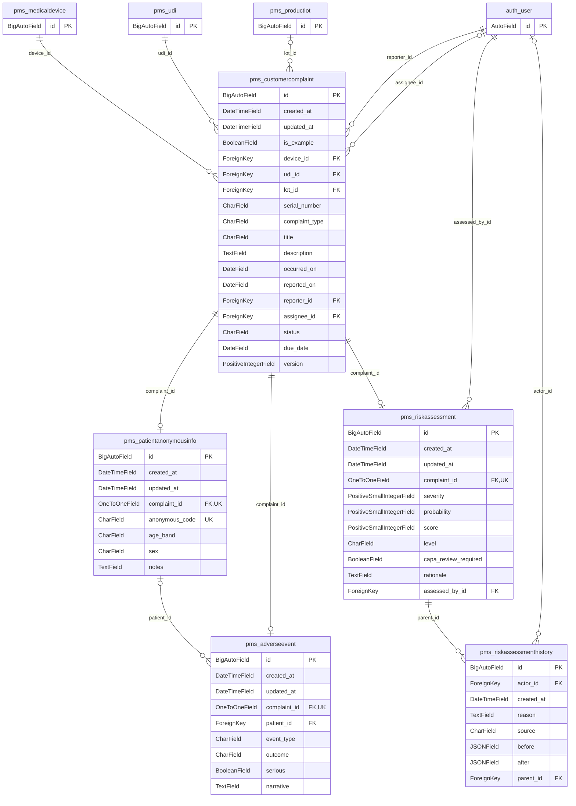
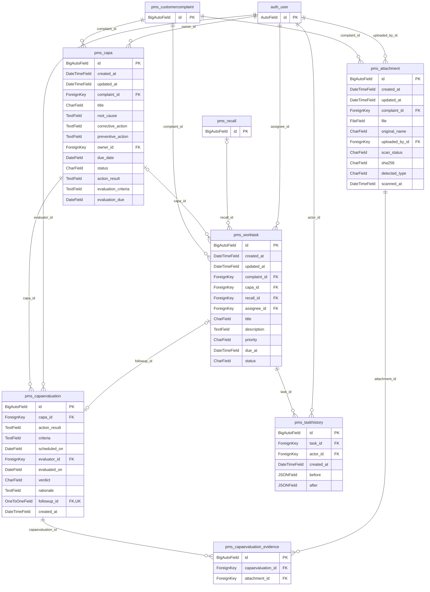
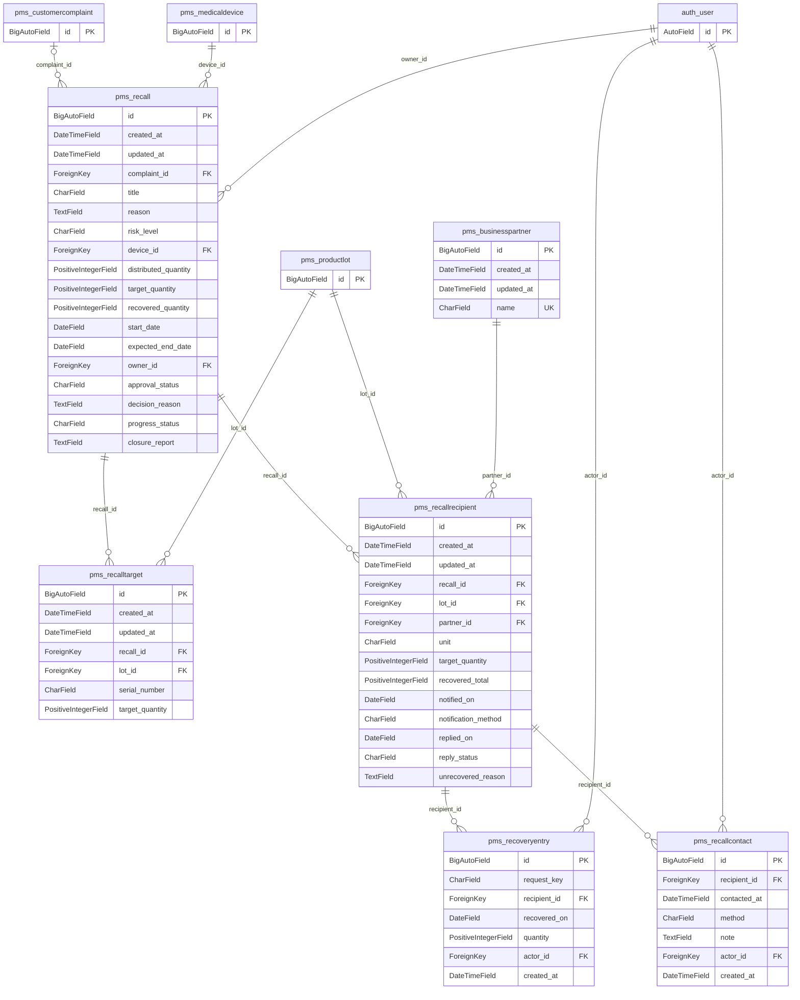
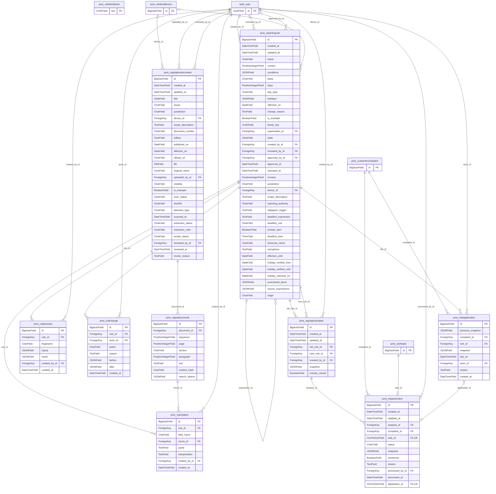
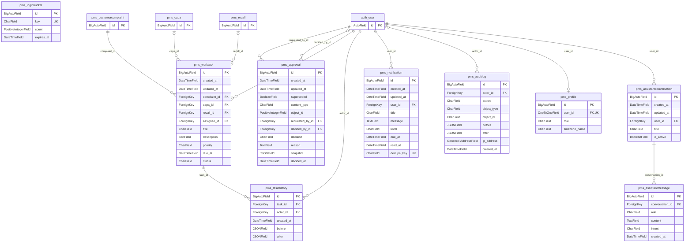
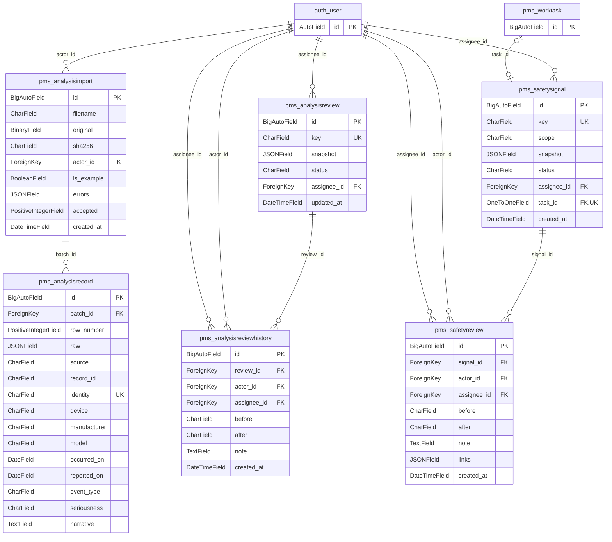
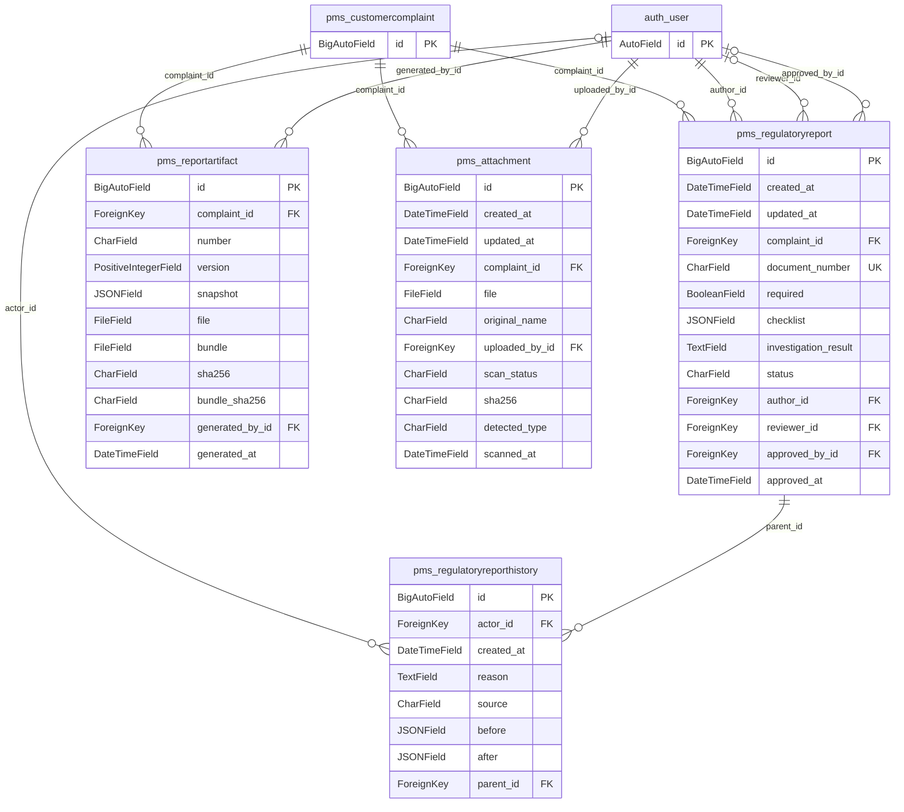

# MedWatch PMS ERD

## 도메인 개요

사건은 제품·UDI·선택 LOT를 참조하며 위험평가, 이상사례, CAPA, 보고서, 리콜 및 업무를 모은다. 규칙은 원문 청크를 인용하는 버전으로 관리하고 사건 적용은 당시 스냅샷을 남긴다. 외부 CSV 분석 레코드는 제품 문자열을 사용하며 내부 제품 FK로 자동 연결하지 않는다.

기존 구현: 아래 물리 관계 중 두 History 테이블을 제외한 모델. 이번 추가: RiskAssessmentHistory·RegulatoryReportHistory, 삭제 보호, 제약과 조회 인덱스. 향후 제안: 제출 접수증 전용 엔터티, 안전 신호의 JSON 증거·조치 연결을 명시적 FK 연결 테이블로 전환, 범용 승인 대상의 명시 FK 전환. 제안은 아래 ERD에 구현처럼 표시하지 않았다.

## 물리 ERD 표기

`||` 필수 1, `o|` 선택 0..1, `o{` 선택 0..N. 자식의 FK null 여부가 부모 쪽 선택성을 결정한다. OneToOne은 자식 쪽 0..1이다. 모든 자식 FK 관계의 부모는 자식을 갖지 않을 수 있다. N:M은 실제 중간 테이블의 두 1:N 관계로 표시한다. 필드는 실제 DB column이며 PK/FK/UK를 표시한다. 타입은 Django 물리 필드 타입이며 DB별 SQL 매핑은 데이터 사전에 적었다. 반복 엔터티는 같은 테이블이다.

Approval.content_type/object_id, AuditLog.object_type/object_id, SafetyReview.links, 신호 snapshot의 evidence IDs는 논리 참조이며 FK 선을 그리지 않았다. family_key도 RuleFamilyLock.key에 대한 FK가 아니다. 제출은 RegulatoryReport.status=SUBMITTED일 뿐 별도 Submission 모델은 없다.

## 사용자·역할·제품·UDI·LOT

## 불만·이상사례·익명 환자·위험평가

## CAPA·효과성 평가·후속 조치

## 리콜·대상·거래처·회수 원장

## 규정·청크·규칙 버전·적용·개정 영향

## 승인·담당 업무·알림·감사

## 분석 수집·레코드·안전 신호·검토

## 제출·보고서·증빙 (구현 모델만)

