# MedWatch PMS ERD

## 도메인 개요

사건은 제품·UDI·선택 LOT를 참조하며 위험평가, 이상사례, CAPA, 보고서, 리콜 및 업무를 모은다. 규칙은 원문 청크를 인용하는 버전으로 관리하고 사건 적용은 당시 스냅샷을 남긴다. 외부 CSV 분석 레코드는 제품 문자열을 사용하며 내부 제품 FK로 자동 연결하지 않는다.

기존 구현: 아래 물리 관계 중 두 History 테이블을 제외한 모델. 이번 추가: RiskAssessmentHistory·RegulatoryReportHistory, 삭제 보호, 제약과 조회 인덱스. RA 확장: 1~4단계의 26개 기반 모델과 실무 추적 모델 17개, 기존 WorkTask·Attachment의 사건/RA 프로필 중 하나를 택하는 문맥, 프로필·국가·조직·버전·업무·증빙의 명시 관계. 각 영역의 구현 상태는 [RA 요구사항 매트릭스](ra-requirements-matrix.md) 참조. 향후 제안: 안전 신호의 JSON 증거·조치 연결을 명시적 FK 연결 테이블로 전환, 범용 승인 대상의 명시 FK 전환. 제안은 아래 ERD에 구현처럼 표시하지 않았다.

## 물리 ERD 표기

`||` 필수 1, `o|` 선택 0..1, `o{` 선택 0..N. 자식의 FK null 여부가 부모 쪽 선택성을 결정한다. OneToOne은 자식 쪽 0..1이다. 모든 자식 FK 관계의 부모는 자식을 갖지 않을 수 있다. N:M은 실제 중간 테이블의 두 1:N 관계로 표시한다. 필드는 실제 DB column이며 PK/FK/UK를 표시한다. 타입은 Django 물리 필드 타입이며 DB별 SQL 매핑은 데이터 사전에 적었다. 반복 엔터티는 같은 테이블이다.

Approval.content_type/object_id, AuditLog.object_type/object_id, SafetyReview.links, 신호 snapshot의 evidence IDs는 논리 참조이며 FK 선을 그리지 않았다. family_key도 RuleFamilyLock.key에 대한 FK가 아니다. 기존 PMS 제출 상태와 별도로 RA 인허가에는 수동 기록 SubmissionPackage 버전이 있다. 외부 자동 제출 기능은 없다.

## 해외 인허가와 시장별 검토

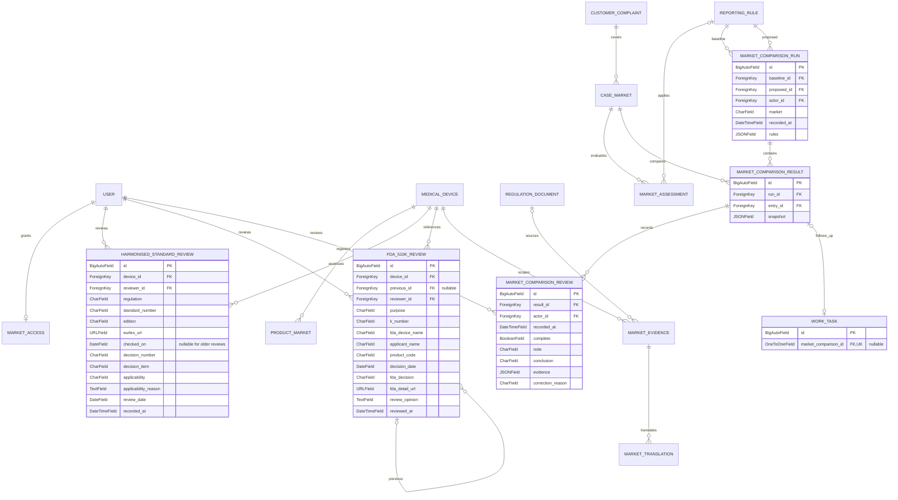

- **미국 FDA 510(k)** 검토는 제품에 속하는 추가 전용 기록이다. 선택적 `previous_id`는 같은 제품의 이전 검토를 가리키며, K-number·FDA 원문 URL·내부 검토 의견 등의 차이를 보여준다. 원문 결정은 `fda_decision`, 내부 의견은 `review_opinion`에 기록한다. 미국 등록 상태와 신청 결과는 각자의 업무 모델에서 관리한다.
- **EU 조화표준**은 공식 목록 근거와 제품 적용 판단을 같은 검토 행의 별도 필드에 기록한다. 직전 검토는 같은 제품·규정·표준 번호에서 현재 행보다 앞선 최신 행을 조회한다.
- **시장별 규칙 비교**는 실행의 `rules`와 결과의 `snapshot`에 당시 값을 저장한다. 검토 결론과 정정은 별도 행으로 추가하고, 선택한 문서 정보는 `evidence` JSON에 보존한다. 후속 업무는 선택적 일대일 관계다. CSV는 저장된 비교 결과와 최신 검토 상태를 읽는다.

## 사용자·역할·제품·UDI·LOT

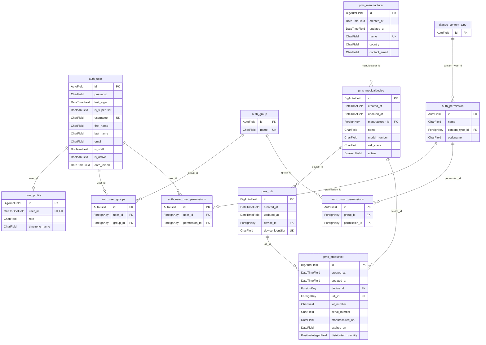

## 불만·이상사례·익명 환자·위험평가

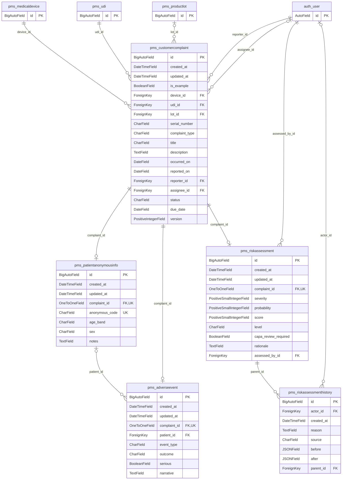

## CAPA·효과성 평가·후속 조치

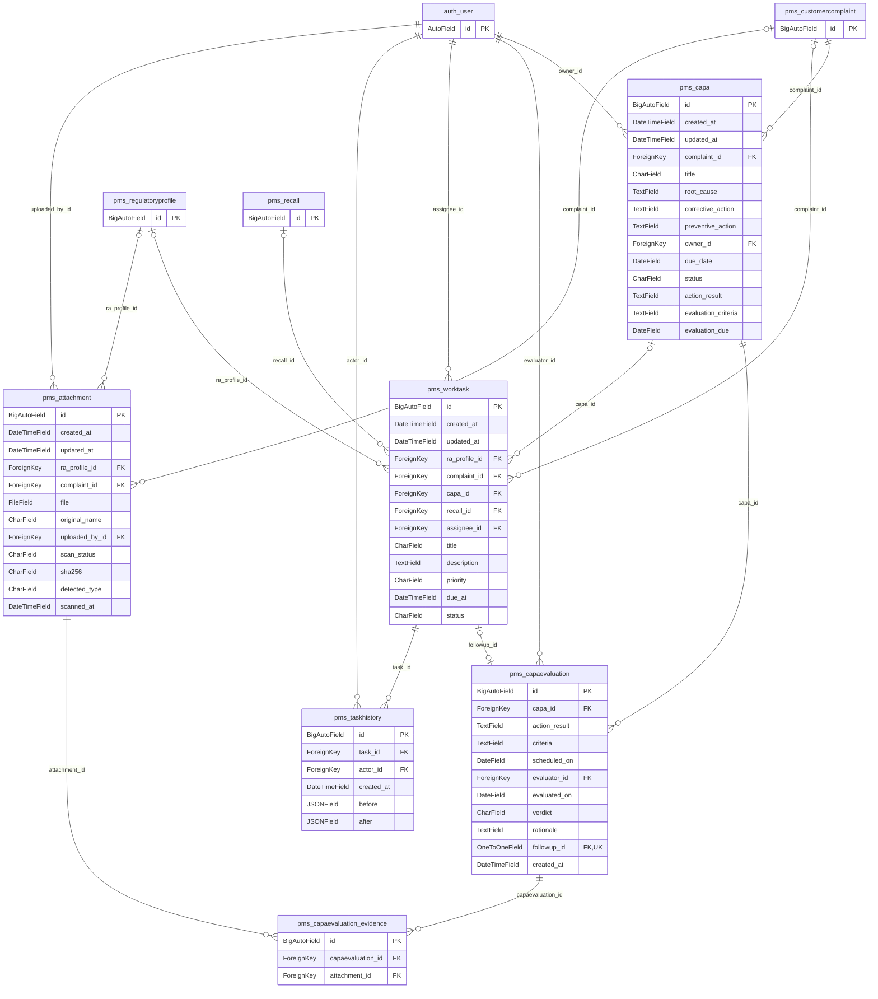

## 리콜·대상·거래처·회수 원장

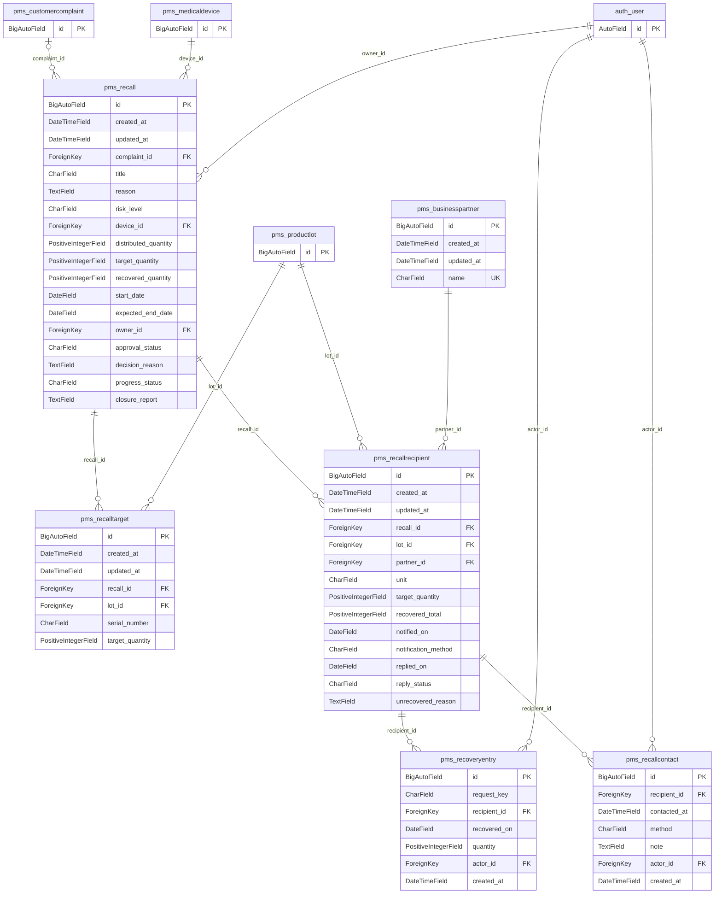

## 규정·청크·규칙 버전·적용·개정 영향


## 승인·담당 업무·알림·감사

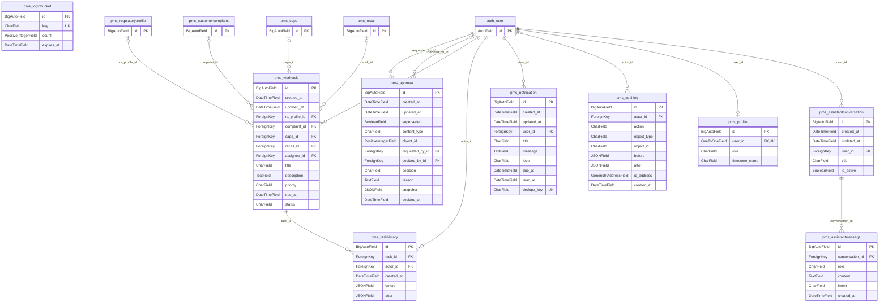

## 분석 수집·레코드·안전 신호·검토

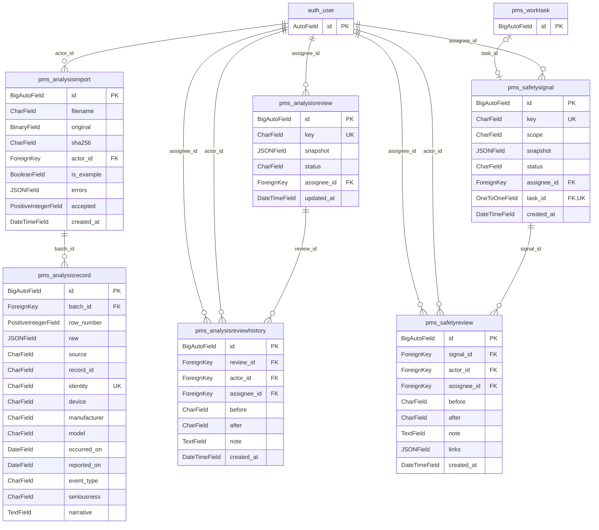

## 제출·보고서·증빙 (구현 모델만)

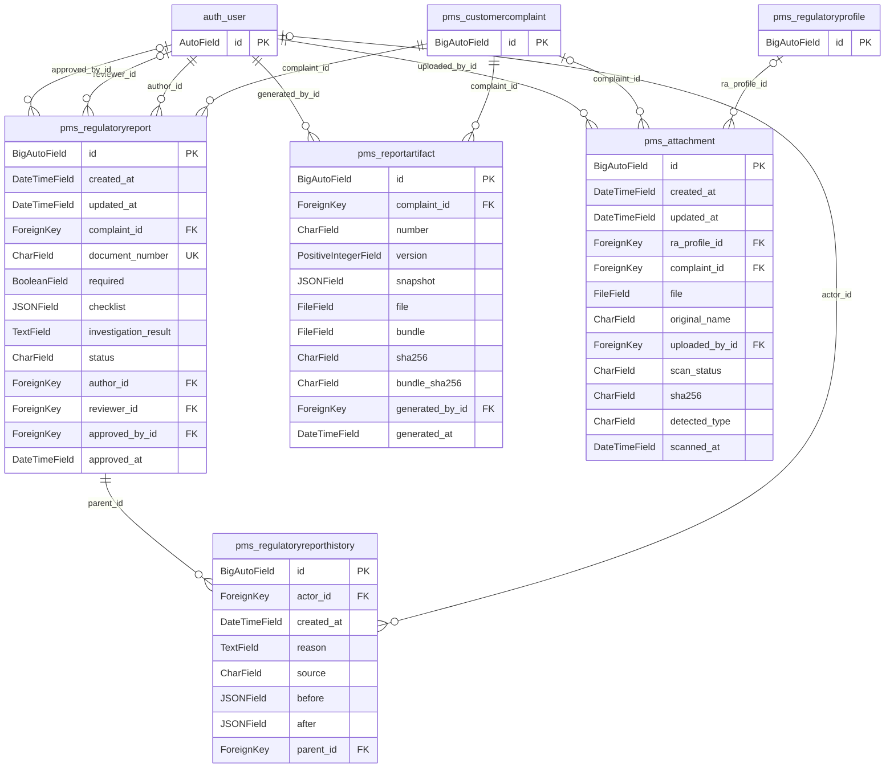

## RA 1단계: 규제 프로필·요구사항·인허가·갱신·제출 패키지

```mermaid
erDiagram
    pms_regulatoryprofile {
        BigAutoField id PK
        CharField title
        ForeignKey owner_id FK
        ForeignKey reviewer_id FK
        ForeignKey created_by_id FK
        ForeignKey reviewed_by_id FK
        DateTimeField reviewed_at
        ForeignKey approved_by_id FK
        DateTimeField approved_at
        JSONField approval_snapshot
        CharField state
        PositiveIntegerField revision
        BooleanField is_example
        DateTimeField created_at
        DateTimeField updated_at
        ForeignKey device_id FK
        CharField jurisdiction
        ForeignKey organization_id FK
        CharField organization_role
        CharField product_family
        CharField classification
        TextField classification_basis
        TextField intended_use
        TextField authorized_scope
        CharField applicability
        TextField rationale
        ForeignKey source_id FK
        CharField source_url
        DateField source_checked_on
        ForeignKey source_checked_by_id FK
        DateField effective_on
        DateField next_review_on
    }
    pms_rarequirement {
        BigAutoField id PK
        CharField title
        ForeignKey owner_id FK
        ForeignKey reviewer_id FK
        ForeignKey created_by_id FK
        ForeignKey reviewed_by_id FK
        DateTimeField reviewed_at
        ForeignKey approved_by_id FK
        DateTimeField approved_at
        JSONField approval_snapshot
        CharField state
        PositiveIntegerField revision
        BooleanField is_example
        DateTimeField created_at
        DateTimeField updated_at
        ForeignKey profile_id FK
        CharField internal_id
        ForeignKey source_id FK
        ForeignKey clause_id FK
        CharField clause_reference
        CharField applicability
        TextField applicability_reason
        TextField activity
        TextField deliverable
        CharField fulfillment
        DateField due_on
        PositiveIntegerField review_interval_days
        DateField confirmed_on
        DateField next_review_on
        CharField source_url
        DateField source_checked_on
        ForeignKey source_checked_by_id FK
    }
    pms_marketingauthorization {
        BigAutoField id PK
        CharField title
        ForeignKey owner_id FK
        ForeignKey reviewer_id FK
        ForeignKey created_by_id FK
        ForeignKey reviewed_by_id FK
        DateTimeField reviewed_at
        ForeignKey approved_by_id FK
        DateTimeField approved_at
        JSONField approval_snapshot
        CharField state
        PositiveIntegerField revision
        BooleanField is_example
        DateTimeField created_at
        DateTimeField updated_at
        ForeignKey profile_id FK
        CharField kind
        CharField number
        CharField authority
        DateField issued_on
        DateField expires_on
        TextField conditions
        CharField status
        DateField renewal_prepare_on
        TextField renewal_basis
        DateField verified_on
        CharField verification_source
    }
    pms_authorizationevent {
        BigAutoField id PK
        ForeignKey authorization_id FK
        CharField status
        TextField reason
        ForeignKey actor_id FK
        DateTimeField created_at
        JSONField snapshot
    }
    pms_submissionpackage {
        BigAutoField id PK
        CharField title
        ForeignKey owner_id FK
        ForeignKey reviewer_id FK
        ForeignKey created_by_id FK
        ForeignKey reviewed_by_id FK
        DateTimeField reviewed_at
        ForeignKey approved_by_id FK
        DateTimeField approved_at
        JSONField approval_snapshot
        CharField state
        PositiveIntegerField revision
        BooleanField is_example
        DateTimeField created_at
        DateTimeField updated_at
        ForeignKey profile_id FK
        ForeignKey product_revision_id FK
        ForeignKey change_id FK
        ForeignKey authorization_id FK
        PositiveIntegerField version
        TextField content_description
        CharField receipt_reference
        ForeignKey receipt_id FK
        DateField recorded_submitted_on
        JSONField frozen_snapshot
    }
    pms_rarequirement_evidence {
        BigAutoField id PK
        ForeignKey rarequirement_id FK
        ForeignKey attachment_id FK
    }
    pms_rarequirement_tasks {
        BigAutoField id PK
        ForeignKey rarequirement_id FK
        ForeignKey worktask_id FK
    }
    pms_marketingauthorization_evidence {
        BigAutoField id PK
        ForeignKey marketingauthorization_id FK
        ForeignKey attachment_id FK
    }
    pms_marketingauthorization_tasks {
        BigAutoField id PK
        ForeignKey marketingauthorization_id FK
        ForeignKey worktask_id FK
    }
    pms_submissionpackage_evidence {
        BigAutoField id PK
        ForeignKey submissionpackage_id FK
        ForeignKey attachment_id FK
    }
    pms_submissionpackage_tasks {
        BigAutoField id PK
        ForeignKey submissionpackage_id FK
        ForeignKey worktask_id FK
    }
    auth_user {
        AutoField id PK
    }
    pms_medicaldevice {
        BigAutoField id PK
    }
    pms_businesspartner {
        BigAutoField id PK
    }
    pms_regulationdocument {
        BigAutoField id PK
    }
    pms_regulationchunk {
        BigAutoField id PK
    }
    pms_productrevision {
        BigAutoField id PK
    }
    pms_productchange {
        BigAutoField id PK
    }
    pms_attachment {
        BigAutoField id PK
    }
    pms_worktask {
        BigAutoField id PK
    }
    auth_user ||--o{ pms_regulatoryprofile : "owner_id"
    auth_user |o--o{ pms_regulatoryprofile : "reviewer_id"
    auth_user ||--o{ pms_regulatoryprofile : "created_by_id"
    auth_user |o--o{ pms_regulatoryprofile : "reviewed_by_id"
    auth_user |o--o{ pms_regulatoryprofile : "approved_by_id"
    pms_medicaldevice ||--o{ pms_regulatoryprofile : "device_id"
    pms_businesspartner ||--o{ pms_regulatoryprofile : "organization_id"
    pms_regulationdocument |o--o{ pms_regulatoryprofile : "source_id"
    auth_user |o--o{ pms_regulatoryprofile : "source_checked_by_id"
    auth_user ||--o{ pms_rarequirement : "owner_id"
    auth_user |o--o{ pms_rarequirement : "reviewer_id"
    auth_user ||--o{ pms_rarequirement : "created_by_id"
    auth_user |o--o{ pms_rarequirement : "reviewed_by_id"
    auth_user |o--o{ pms_rarequirement : "approved_by_id"
    pms_regulatoryprofile ||--o{ pms_rarequirement : "profile_id"
    pms_regulationdocument |o--o{ pms_rarequirement : "source_id"
    pms_regulationchunk |o--o{ pms_rarequirement : "clause_id"
    auth_user |o--o{ pms_rarequirement : "source_checked_by_id"
    auth_user ||--o{ pms_marketingauthorization : "owner_id"
    auth_user |o--o{ pms_marketingauthorization : "reviewer_id"
    auth_user ||--o{ pms_marketingauthorization : "created_by_id"
    auth_user |o--o{ pms_marketingauthorization : "reviewed_by_id"
    auth_user |o--o{ pms_marketingauthorization : "approved_by_id"
    pms_regulatoryprofile ||--o{ pms_marketingauthorization : "profile_id"
    pms_marketingauthorization ||--o{ pms_authorizationevent : "authorization_id"
    auth_user ||--o{ pms_authorizationevent : "actor_id"
    auth_user ||--o{ pms_submissionpackage : "owner_id"
    auth_user |o--o{ pms_submissionpackage : "reviewer_id"
    auth_user ||--o{ pms_submissionpackage : "created_by_id"
    auth_user |o--o{ pms_submissionpackage : "reviewed_by_id"
    auth_user |o--o{ pms_submissionpackage : "approved_by_id"
    pms_regulatoryprofile ||--o{ pms_submissionpackage : "profile_id"
    pms_productrevision |o--o{ pms_submissionpackage : "product_revision_id"
    pms_productchange |o--o{ pms_submissionpackage : "change_id"
    pms_marketingauthorization ||--o{ pms_submissionpackage : "authorization_id"
    pms_attachment |o--o{ pms_submissionpackage : "receipt_id"
    pms_rarequirement ||--o{ pms_rarequirement_evidence : "rarequirement_id"
    pms_attachment ||--o{ pms_rarequirement_evidence : "attachment_id"
    pms_rarequirement ||--o{ pms_rarequirement_tasks : "rarequirement_id"
    pms_worktask ||--o{ pms_rarequirement_tasks : "worktask_id"
    pms_marketingauthorization ||--o{ pms_marketingauthorization_evidence : "marketingauthorization_id"
    pms_attachment ||--o{ pms_marketingauthorization_evidence : "attachment_id"
    pms_marketingauthorization ||--o{ pms_marketingauthorization_tasks : "marketingauthorization_id"
    pms_worktask ||--o{ pms_marketingauthorization_tasks : "worktask_id"
    pms_submissionpackage ||--o{ pms_submissionpackage_evidence : "submissionpackage_id"
    pms_attachment ||--o{ pms_submissionpackage_evidence : "attachment_id"
    pms_submissionpackage ||--o{ pms_submissionpackage_tasks : "submissionpackage_id"
    pms_worktask ||--o{ pms_submissionpackage_tasks : "worktask_id"
```

## RA 2단계: 제품 변경·제품 버전·통제 문서·라벨

```mermaid
erDiagram
    pms_productrevision {
        BigAutoField id PK
        CharField title
        ForeignKey owner_id FK
        ForeignKey reviewer_id FK
        ForeignKey created_by_id FK
        ForeignKey reviewed_by_id FK
        DateTimeField reviewed_at
        ForeignKey approved_by_id FK
        DateTimeField approved_at
        JSONField approval_snapshot
        CharField state
        PositiveIntegerField revision
        BooleanField is_example
        DateTimeField created_at
        DateTimeField updated_at
        ForeignKey profile_id FK
        CharField version
        TextField description
        ForeignKey previous_id FK
    }
    pms_productchange {
        BigAutoField id PK
        CharField title
        ForeignKey owner_id FK
        ForeignKey reviewer_id FK
        ForeignKey created_by_id FK
        ForeignKey reviewed_by_id FK
        DateTimeField reviewed_at
        ForeignKey approved_by_id FK
        DateTimeField approved_at
        JSONField approval_snapshot
        CharField state
        PositiveIntegerField revision
        BooleanField is_example
        DateTimeField created_at
        DateTimeField updated_at
        ForeignKey profile_id FK
        CharField category
        ForeignKey from_revision_id FK
        ForeignKey to_revision_id FK
        TextField before_content
        TextField after_content
        TextField reason
        JSONField impact_checklist
        CharField submission_decision
        TextField decision_basis
        ForeignKey authorization_id FK
        DateField implemented_on
        TextField implementation_confirmation
    }
    pms_controlleddocument {
        BigAutoField id PK
        CharField title
        ForeignKey owner_id FK
        ForeignKey reviewer_id FK
        ForeignKey created_by_id FK
        ForeignKey reviewed_by_id FK
        DateTimeField reviewed_at
        ForeignKey approved_by_id FK
        DateTimeField approved_at
        JSONField approval_snapshot
        CharField state
        PositiveIntegerField revision
        BooleanField is_example
        DateTimeField created_at
        DateTimeField updated_at
        ForeignKey profile_id FK
        CharField category
        CharField number
        PositiveIntegerField version
        TextField body
        ForeignKey primary_file_id FK
        DateField effective_on
        DateField next_review_on
        TextField change_reason
        ForeignKey supersedes_id FK
    }
    pms_labelversion {
        BigAutoField id PK
        CharField title
        ForeignKey owner_id FK
        ForeignKey reviewer_id FK
        ForeignKey created_by_id FK
        ForeignKey reviewed_by_id FK
        DateTimeField reviewed_at
        ForeignKey approved_by_id FK
        DateTimeField approved_at
        JSONField approval_snapshot
        CharField state
        PositiveIntegerField revision
        BooleanField is_example
        DateTimeField created_at
        DateTimeField updated_at
        ForeignKey profile_id FK
        CharField artifact_type
        CharField language
        PositiveIntegerField version
        ForeignKey document_id FK
        ForeignKey product_revision_id FK
        ForeignKey authorization_id FK
        ForeignKey change_id FK
        ForeignKey udi_id FK
        JSONField review_checklist
        ForeignKey translation_reviewer_id FK
        DateField translation_reviewed_on
        TextField translation_notes
        DateField effective_on
        ForeignKey previous_id FK
        ForeignKey safety_action_id FK
        TextField safety_change_reason
    }
    pms_productrevision_evidence {
        BigAutoField id PK
        ForeignKey productrevision_id FK
        ForeignKey attachment_id FK
    }
    pms_productrevision_tasks {
        BigAutoField id PK
        ForeignKey productrevision_id FK
        ForeignKey worktask_id FK
    }
    pms_productchange_evidence {
        BigAutoField id PK
        ForeignKey productchange_id FK
        ForeignKey attachment_id FK
    }
    pms_productchange_tasks {
        BigAutoField id PK
        ForeignKey productchange_id FK
        ForeignKey worktask_id FK
    }
    pms_productchange_lots {
        BigAutoField id PK
        ForeignKey productchange_id FK
        ForeignKey productlot_id FK
    }
    pms_productchange_documents {
        BigAutoField id PK
        ForeignKey productchange_id FK
        ForeignKey controlleddocument_id FK
    }
    pms_controlleddocument_evidence {
        BigAutoField id PK
        ForeignKey controlleddocument_id FK
        ForeignKey attachment_id FK
    }
    pms_controlleddocument_tasks {
        BigAutoField id PK
        ForeignKey controlleddocument_id FK
        ForeignKey worktask_id FK
    }
    pms_labelversion_evidence {
        BigAutoField id PK
        ForeignKey labelversion_id FK
        ForeignKey attachment_id FK
    }
    pms_labelversion_tasks {
        BigAutoField id PK
        ForeignKey labelversion_id FK
        ForeignKey worktask_id FK
    }
    pms_labelversion_lots {
        BigAutoField id PK
        ForeignKey labelversion_id FK
        ForeignKey productlot_id FK
    }
    auth_user {
        AutoField id PK
    }
    pms_regulatoryprofile {
        BigAutoField id PK
    }
    pms_marketingauthorization {
        BigAutoField id PK
    }
    pms_attachment {
        BigAutoField id PK
    }
    pms_udi {
        BigAutoField id PK
    }
    pms_fieldsafetyaction {
        BigAutoField id PK
    }
    pms_worktask {
        BigAutoField id PK
    }
    pms_productlot {
        BigAutoField id PK
    }
    auth_user ||--o{ pms_productrevision : "owner_id"
    auth_user |o--o{ pms_productrevision : "reviewer_id"
    auth_user ||--o{ pms_productrevision : "created_by_id"
    auth_user |o--o{ pms_productrevision : "reviewed_by_id"
    auth_user |o--o{ pms_productrevision : "approved_by_id"
    pms_regulatoryprofile ||--o{ pms_productrevision : "profile_id"
    pms_productrevision |o--o{ pms_productrevision : "previous_id"
    auth_user ||--o{ pms_productchange : "owner_id"
    auth_user |o--o{ pms_productchange : "reviewer_id"
    auth_user ||--o{ pms_productchange : "created_by_id"
    auth_user |o--o{ pms_productchange : "reviewed_by_id"
    auth_user |o--o{ pms_productchange : "approved_by_id"
    pms_regulatoryprofile ||--o{ pms_productchange : "profile_id"
    pms_productrevision ||--o{ pms_productchange : "from_revision_id"
    pms_productrevision ||--o{ pms_productchange : "to_revision_id"
    pms_marketingauthorization |o--o{ pms_productchange : "authorization_id"
    auth_user ||--o{ pms_controlleddocument : "owner_id"
    auth_user |o--o{ pms_controlleddocument : "reviewer_id"
    auth_user ||--o{ pms_controlleddocument : "created_by_id"
    auth_user |o--o{ pms_controlleddocument : "reviewed_by_id"
    auth_user |o--o{ pms_controlleddocument : "approved_by_id"
    pms_regulatoryprofile ||--o{ pms_controlleddocument : "profile_id"
    pms_attachment |o--o{ pms_controlleddocument : "primary_file_id"
    pms_controlleddocument |o--o{ pms_controlleddocument : "supersedes_id"
    auth_user ||--o{ pms_labelversion : "owner_id"
    auth_user |o--o{ pms_labelversion : "reviewer_id"
    auth_user ||--o{ pms_labelversion : "created_by_id"
    auth_user |o--o{ pms_labelversion : "reviewed_by_id"
    auth_user |o--o{ pms_labelversion : "approved_by_id"
    pms_regulatoryprofile ||--o{ pms_labelversion : "profile_id"
    pms_controlleddocument ||--o{ pms_labelversion : "document_id"
    pms_productrevision ||--o{ pms_labelversion : "product_revision_id"
    pms_marketingauthorization |o--o{ pms_labelversion : "authorization_id"
    pms_productchange |o--o{ pms_labelversion : "change_id"
    pms_udi |o--o{ pms_labelversion : "udi_id"
    auth_user |o--o{ pms_labelversion : "translation_reviewer_id"
    pms_labelversion |o--o{ pms_labelversion : "previous_id"
    pms_fieldsafetyaction |o--o{ pms_labelversion : "safety_action_id"
    pms_productrevision ||--o{ pms_productrevision_evidence : "productrevision_id"
    pms_attachment ||--o{ pms_productrevision_evidence : "attachment_id"
    pms_productrevision ||--o{ pms_productrevision_tasks : "productrevision_id"
    pms_worktask ||--o{ pms_productrevision_tasks : "worktask_id"
    pms_productchange ||--o{ pms_productchange_evidence : "productchange_id"
    pms_attachment ||--o{ pms_productchange_evidence : "attachment_id"
    pms_productchange ||--o{ pms_productchange_tasks : "productchange_id"
    pms_worktask ||--o{ pms_productchange_tasks : "worktask_id"
    pms_productchange ||--o{ pms_productchange_lots : "productchange_id"
    pms_productlot ||--o{ pms_productchange_lots : "productlot_id"
    pms_productchange ||--o{ pms_productchange_documents : "productchange_id"
    pms_controlleddocument ||--o{ pms_productchange_documents : "controlleddocument_id"
    pms_controlleddocument ||--o{ pms_controlleddocument_evidence : "controlleddocument_id"
    pms_attachment ||--o{ pms_controlleddocument_evidence : "attachment_id"
    pms_controlleddocument ||--o{ pms_controlleddocument_tasks : "controlleddocument_id"
    pms_worktask ||--o{ pms_controlleddocument_tasks : "worktask_id"
    pms_labelversion ||--o{ pms_labelversion_evidence : "labelversion_id"
    pms_attachment ||--o{ pms_labelversion_evidence : "attachment_id"
    pms_labelversion ||--o{ pms_labelversion_tasks : "labelversion_id"
    pms_worktask ||--o{ pms_labelversion_tasks : "worktask_id"
    pms_labelversion ||--o{ pms_labelversion_lots : "labelversion_id"
    pms_productlot ||--o{ pms_labelversion_lots : "productlot_id"
```

## RA 3단계: 제품 위험관리·안전 정보·현장 조치·공급자

```mermaid
erDiagram
    pms_riskcriteria {
        BigAutoField id PK
        CharField title
        ForeignKey owner_id FK
        ForeignKey reviewer_id FK
        ForeignKey created_by_id FK
        ForeignKey reviewed_by_id FK
        DateTimeField reviewed_at
        ForeignKey approved_by_id FK
        DateTimeField approved_at
        JSONField approval_snapshot
        CharField state
        PositiveIntegerField revision
        BooleanField is_example
        DateTimeField created_at
        DateTimeField updated_at
        ForeignKey profile_id FK
        PositiveIntegerField version
        TextField estimation_method
        TextField acceptance_criteria
        TextField basis
        ForeignKey document_id FK
    }
    pms_productrisk {
        BigAutoField id PK
        CharField title
        ForeignKey owner_id FK
        ForeignKey reviewer_id FK
        ForeignKey created_by_id FK
        ForeignKey reviewed_by_id FK
        DateTimeField reviewed_at
        ForeignKey approved_by_id FK
        DateTimeField approved_at
        JSONField approval_snapshot
        CharField state
        PositiveIntegerField revision
        BooleanField is_example
        DateTimeField created_at
        DateTimeField updated_at
        ForeignKey profile_id FK
        ForeignKey criteria_id FK
        ForeignKey document_id FK
        TextField hazard
        TextField hazardous_situation
        TextField harm
        TextField estimate
        TextField controls
        TextField verification
        CharField residual_decision
        TextField residual_rationale
        TextField benefit_risk_rationale
        DateField next_review_on
    }
    pms_safetyinformation {
        BigAutoField id PK
        CharField title
        ForeignKey owner_id FK
        ForeignKey reviewer_id FK
        ForeignKey created_by_id FK
        ForeignKey reviewed_by_id FK
        DateTimeField reviewed_at
        ForeignKey approved_by_id FK
        DateTimeField approved_at
        JSONField approval_snapshot
        CharField state
        PositiveIntegerField revision
        BooleanField is_example
        DateTimeField created_at
        DateTimeField updated_at
        ForeignKey profile_id FK
        CharField source_url
        CharField source_identifier
        DateField collected_on
        ForeignKey original_id FK
        CharField relevance
        TextField relevance_reason
        CharField reporting_decision
        TextField reporting_basis
        ForeignKey report_id FK
    }
    pms_fieldsafetyaction {
        BigAutoField id PK
        CharField title
        ForeignKey owner_id FK
        ForeignKey reviewer_id FK
        ForeignKey created_by_id FK
        ForeignKey reviewed_by_id FK
        DateTimeField reviewed_at
        ForeignKey approved_by_id FK
        DateTimeField approved_at
        JSONField approval_snapshot
        CharField state
        PositiveIntegerField revision
        BooleanField is_example
        DateTimeField created_at
        DateTimeField updated_at
        ForeignKey profile_id FK
        CharField action_type
        ForeignKey information_id FK
        ForeignKey complaint_id FK
        ForeignKey signal_id FK
        ForeignKey capa_id FK
        OneToOneField recall_id FK,UK
        ForeignKey notice_document_id FK
        TextField rationale
        TextField effectiveness_criteria
        TextField closure_rationale
    }
    pms_fieldactionrecipient {
        BigAutoField id PK
        CharField title
        ForeignKey owner_id FK
        ForeignKey reviewer_id FK
        ForeignKey created_by_id FK
        ForeignKey reviewed_by_id FK
        DateTimeField reviewed_at
        ForeignKey approved_by_id FK
        DateTimeField approved_at
        JSONField approval_snapshot
        CharField state
        PositiveIntegerField revision
        BooleanField is_example
        DateTimeField created_at
        DateTimeField updated_at
        ForeignKey profile_id FK
        ForeignKey action_id FK
        ForeignKey partner_id FK
        ForeignKey lot_id FK
        CharField unit
        PositiveIntegerField target_quantity
        PositiveIntegerField completed_quantity
        DateField notified_on
        DateField acknowledged_on
        DateField completed_on
        TextField outcome
    }
    pms_fieldactioncontact {
        BigAutoField id PK
        ForeignKey recipient_id FK
        ForeignKey actor_id FK
        DateTimeField contacted_at
        CharField method
        TextField note
        ForeignKey evidence_id FK
    }
    pms_fieldactionevaluation {
        BigAutoField id PK
        ForeignKey action_id FK
        ForeignKey actor_id FK
        DateTimeField evaluated_at
        CharField verdict
        TextField rationale
        ForeignKey evidence_id FK
        JSONField snapshot
    }
    pms_supplierrecord {
        BigAutoField id PK
        CharField title
        ForeignKey owner_id FK
        ForeignKey reviewer_id FK
        ForeignKey created_by_id FK
        ForeignKey reviewed_by_id FK
        DateTimeField reviewed_at
        ForeignKey approved_by_id FK
        DateTimeField approved_at
        JSONField approval_snapshot
        CharField state
        PositiveIntegerField revision
        BooleanField is_example
        DateTimeField created_at
        DateTimeField updated_at
        ForeignKey profile_id FK
        ForeignKey partner_id FK
        CharField supplier_type
        CharField site_reference
        TextField process_service
        TextField evaluation_criteria
        ForeignKey criteria_document_id FK
        DateField next_review_on
        TextField nonconformity_reference
    }
    pms_suppliermaterial {
        BigAutoField id PK
        CharField title
        ForeignKey owner_id FK
        ForeignKey reviewer_id FK
        ForeignKey created_by_id FK
        ForeignKey reviewed_by_id FK
        DateTimeField reviewed_at
        ForeignKey approved_by_id FK
        DateTimeField approved_at
        JSONField approval_snapshot
        CharField state
        PositiveIntegerField revision
        BooleanField is_example
        DateTimeField created_at
        DateTimeField updated_at
        ForeignKey profile_id FK
        ForeignKey supplier_id FK
        CharField category
        CharField version
        DateField issued_on
        DateField expires_on
        TextField deficiencies
        DateField next_review_on
        TextField change_notice
        TextField impact_review
    }
    pms_riskcriteria_evidence {
        BigAutoField id PK
        ForeignKey riskcriteria_id FK
        ForeignKey attachment_id FK
    }
    pms_riskcriteria_tasks {
        BigAutoField id PK
        ForeignKey riskcriteria_id FK
        ForeignKey worktask_id FK
    }
    pms_productrisk_evidence {
        BigAutoField id PK
        ForeignKey productrisk_id FK
        ForeignKey attachment_id FK
    }
    pms_productrisk_tasks {
        BigAutoField id PK
        ForeignKey productrisk_id FK
        ForeignKey worktask_id FK
    }
    pms_productrisk_complaints {
        BigAutoField id PK
        ForeignKey productrisk_id FK
        ForeignKey customercomplaint_id FK
    }
    pms_productrisk_adverse_events {
        BigAutoField id PK
        ForeignKey productrisk_id FK
        ForeignKey adverseevent_id FK
    }
    pms_productrisk_signals {
        BigAutoField id PK
        ForeignKey productrisk_id FK
        ForeignKey safetysignal_id FK
    }
    pms_productrisk_capas {
        BigAutoField id PK
        ForeignKey productrisk_id FK
        ForeignKey capa_id FK
    }
    pms_safetyinformation_evidence {
        BigAutoField id PK
        ForeignKey safetyinformation_id FK
        ForeignKey attachment_id FK
    }
    pms_safetyinformation_tasks {
        BigAutoField id PK
        ForeignKey safetyinformation_id FK
        ForeignKey worktask_id FK
    }
    pms_fieldsafetyaction_evidence {
        BigAutoField id PK
        ForeignKey fieldsafetyaction_id FK
        ForeignKey attachment_id FK
    }
    pms_fieldsafetyaction_tasks {
        BigAutoField id PK
        ForeignKey fieldsafetyaction_id FK
        ForeignKey worktask_id FK
    }
    pms_fieldactionrecipient_evidence {
        BigAutoField id PK
        ForeignKey fieldactionrecipient_id FK
        ForeignKey attachment_id FK
    }
    pms_fieldactionrecipient_tasks {
        BigAutoField id PK
        ForeignKey fieldactionrecipient_id FK
        ForeignKey worktask_id FK
    }
    pms_supplierrecord_evidence {
        BigAutoField id PK
        ForeignKey supplierrecord_id FK
        ForeignKey attachment_id FK
    }
    pms_supplierrecord_tasks {
        BigAutoField id PK
        ForeignKey supplierrecord_id FK
        ForeignKey worktask_id FK
    }
    pms_supplierrecord_capas {
        BigAutoField id PK
        ForeignKey supplierrecord_id FK
        ForeignKey capa_id FK
    }
    pms_suppliermaterial_evidence {
        BigAutoField id PK
        ForeignKey suppliermaterial_id FK
        ForeignKey attachment_id FK
    }
    pms_suppliermaterial_tasks {
        BigAutoField id PK
        ForeignKey suppliermaterial_id FK
        ForeignKey worktask_id FK
    }
    auth_user {
        AutoField id PK
    }
    pms_regulatoryprofile {
        BigAutoField id PK
    }
    pms_controlleddocument {
        BigAutoField id PK
    }
    pms_attachment {
        BigAutoField id PK
    }
    pms_regulatoryreport {
        BigAutoField id PK
    }
    pms_customercomplaint {
        BigAutoField id PK
    }
    pms_safetysignal {
        BigAutoField id PK
    }
    pms_capa {
        BigAutoField id PK
    }
    pms_recall {
        BigAutoField id PK
    }
    pms_businesspartner {
        BigAutoField id PK
    }
    pms_productlot {
        BigAutoField id PK
    }
    pms_worktask {
        BigAutoField id PK
    }
    pms_adverseevent {
        BigAutoField id PK
    }
    auth_user ||--o{ pms_riskcriteria : "owner_id"
    auth_user |o--o{ pms_riskcriteria : "reviewer_id"
    auth_user ||--o{ pms_riskcriteria : "created_by_id"
    auth_user |o--o{ pms_riskcriteria : "reviewed_by_id"
    auth_user |o--o{ pms_riskcriteria : "approved_by_id"
    pms_regulatoryprofile ||--o{ pms_riskcriteria : "profile_id"
    pms_controlleddocument |o--o{ pms_riskcriteria : "document_id"
    auth_user ||--o{ pms_productrisk : "owner_id"
    auth_user |o--o{ pms_productrisk : "reviewer_id"
    auth_user ||--o{ pms_productrisk : "created_by_id"
    auth_user |o--o{ pms_productrisk : "reviewed_by_id"
    auth_user |o--o{ pms_productrisk : "approved_by_id"
    pms_regulatoryprofile ||--o{ pms_productrisk : "profile_id"
    pms_riskcriteria ||--o{ pms_productrisk : "criteria_id"
    pms_controlleddocument |o--o{ pms_productrisk : "document_id"
    auth_user ||--o{ pms_safetyinformation : "owner_id"
    auth_user |o--o{ pms_safetyinformation : "reviewer_id"
    auth_user ||--o{ pms_safetyinformation : "created_by_id"
    auth_user |o--o{ pms_safetyinformation : "reviewed_by_id"
    auth_user |o--o{ pms_safetyinformation : "approved_by_id"
    pms_regulatoryprofile ||--o{ pms_safetyinformation : "profile_id"
    pms_attachment |o--o{ pms_safetyinformation : "original_id"
    pms_regulatoryreport |o--o{ pms_safetyinformation : "report_id"
    auth_user ||--o{ pms_fieldsafetyaction : "owner_id"
    auth_user |o--o{ pms_fieldsafetyaction : "reviewer_id"
    auth_user ||--o{ pms_fieldsafetyaction : "created_by_id"
    auth_user |o--o{ pms_fieldsafetyaction : "reviewed_by_id"
    auth_user |o--o{ pms_fieldsafetyaction : "approved_by_id"
    pms_regulatoryprofile ||--o{ pms_fieldsafetyaction : "profile_id"
    pms_safetyinformation |o--o{ pms_fieldsafetyaction : "information_id"
    pms_customercomplaint |o--o{ pms_fieldsafetyaction : "complaint_id"
    pms_safetysignal |o--o{ pms_fieldsafetyaction : "signal_id"
    pms_capa |o--o{ pms_fieldsafetyaction : "capa_id"
    pms_recall |o--o| pms_fieldsafetyaction : "recall_id"
    pms_controlleddocument ||--o{ pms_fieldsafetyaction : "notice_document_id"
    auth_user ||--o{ pms_fieldactionrecipient : "owner_id"
    auth_user |o--o{ pms_fieldactionrecipient : "reviewer_id"
    auth_user ||--o{ pms_fieldactionrecipient : "created_by_id"
    auth_user |o--o{ pms_fieldactionrecipient : "reviewed_by_id"
    auth_user |o--o{ pms_fieldactionrecipient : "approved_by_id"
    pms_regulatoryprofile ||--o{ pms_fieldactionrecipient : "profile_id"
    pms_fieldsafetyaction ||--o{ pms_fieldactionrecipient : "action_id"
    pms_businesspartner ||--o{ pms_fieldactionrecipient : "partner_id"
    pms_productlot ||--o{ pms_fieldactionrecipient : "lot_id"
    pms_fieldactionrecipient ||--o{ pms_fieldactioncontact : "recipient_id"
    auth_user ||--o{ pms_fieldactioncontact : "actor_id"
    pms_attachment |o--o{ pms_fieldactioncontact : "evidence_id"
    pms_fieldsafetyaction ||--o{ pms_fieldactionevaluation : "action_id"
    auth_user ||--o{ pms_fieldactionevaluation : "actor_id"
    pms_attachment ||--o{ pms_fieldactionevaluation : "evidence_id"
    auth_user ||--o{ pms_supplierrecord : "owner_id"
    auth_user |o--o{ pms_supplierrecord : "reviewer_id"
    auth_user ||--o{ pms_supplierrecord : "created_by_id"
    auth_user |o--o{ pms_supplierrecord : "reviewed_by_id"
    auth_user |o--o{ pms_supplierrecord : "approved_by_id"
    pms_regulatoryprofile ||--o{ pms_supplierrecord : "profile_id"
    pms_businesspartner ||--o{ pms_supplierrecord : "partner_id"
    pms_controlleddocument |o--o{ pms_supplierrecord : "criteria_document_id"
    auth_user ||--o{ pms_suppliermaterial : "owner_id"
    auth_user |o--o{ pms_suppliermaterial : "reviewer_id"
    auth_user ||--o{ pms_suppliermaterial : "created_by_id"
    auth_user |o--o{ pms_suppliermaterial : "reviewed_by_id"
    auth_user |o--o{ pms_suppliermaterial : "approved_by_id"
    pms_regulatoryprofile ||--o{ pms_suppliermaterial : "profile_id"
    pms_supplierrecord ||--o{ pms_suppliermaterial : "supplier_id"
    pms_riskcriteria ||--o{ pms_riskcriteria_evidence : "riskcriteria_id"
    pms_attachment ||--o{ pms_riskcriteria_evidence : "attachment_id"
    pms_riskcriteria ||--o{ pms_riskcriteria_tasks : "riskcriteria_id"
    pms_worktask ||--o{ pms_riskcriteria_tasks : "worktask_id"
    pms_productrisk ||--o{ pms_productrisk_evidence : "productrisk_id"
    pms_attachment ||--o{ pms_productrisk_evidence : "attachment_id"
    pms_productrisk ||--o{ pms_productrisk_tasks : "productrisk_id"
    pms_worktask ||--o{ pms_productrisk_tasks : "worktask_id"
    pms_productrisk ||--o{ pms_productrisk_complaints : "productrisk_id"
    pms_customercomplaint ||--o{ pms_productrisk_complaints : "customercomplaint_id"
    pms_productrisk ||--o{ pms_productrisk_adverse_events : "productrisk_id"
    pms_adverseevent ||--o{ pms_productrisk_adverse_events : "adverseevent_id"
    pms_productrisk ||--o{ pms_productrisk_signals : "productrisk_id"
    pms_safetysignal ||--o{ pms_productrisk_signals : "safetysignal_id"
    pms_productrisk ||--o{ pms_productrisk_capas : "productrisk_id"
    pms_capa ||--o{ pms_productrisk_capas : "capa_id"
    pms_safetyinformation ||--o{ pms_safetyinformation_evidence : "safetyinformation_id"
    pms_attachment ||--o{ pms_safetyinformation_evidence : "attachment_id"
    pms_safetyinformation ||--o{ pms_safetyinformation_tasks : "safetyinformation_id"
    pms_worktask ||--o{ pms_safetyinformation_tasks : "worktask_id"
    pms_fieldsafetyaction ||--o{ pms_fieldsafetyaction_evidence : "fieldsafetyaction_id"
    pms_attachment ||--o{ pms_fieldsafetyaction_evidence : "attachment_id"
    pms_fieldsafetyaction ||--o{ pms_fieldsafetyaction_tasks : "fieldsafetyaction_id"
    pms_worktask ||--o{ pms_fieldsafetyaction_tasks : "worktask_id"
    pms_fieldactionrecipient ||--o{ pms_fieldactionrecipient_evidence : "fieldactionrecipient_id"
    pms_attachment ||--o{ pms_fieldactionrecipient_evidence : "attachment_id"
    pms_fieldactionrecipient ||--o{ pms_fieldactionrecipient_tasks : "fieldactionrecipient_id"
    pms_worktask ||--o{ pms_fieldactionrecipient_tasks : "worktask_id"
    pms_supplierrecord ||--o{ pms_supplierrecord_evidence : "supplierrecord_id"
    pms_attachment ||--o{ pms_supplierrecord_evidence : "attachment_id"
    pms_supplierrecord ||--o{ pms_supplierrecord_tasks : "supplierrecord_id"
    pms_worktask ||--o{ pms_supplierrecord_tasks : "worktask_id"
    pms_supplierrecord ||--o{ pms_supplierrecord_capas : "supplierrecord_id"
    pms_capa ||--o{ pms_supplierrecord_capas : "capa_id"
    pms_suppliermaterial ||--o{ pms_suppliermaterial_evidence : "suppliermaterial_id"
    pms_attachment ||--o{ pms_suppliermaterial_evidence : "attachment_id"
    pms_suppliermaterial ||--o{ pms_suppliermaterial_tasks : "suppliermaterial_id"
    pms_worktask ||--o{ pms_suppliermaterial_tasks : "worktask_id"
```

## RA 4단계: 교육·감사·정기 검토·보존 정책

```mermaid
erDiagram
    pms_trainingrequirement {
        BigAutoField id PK
        CharField title
        ForeignKey owner_id FK
        ForeignKey reviewer_id FK
        ForeignKey created_by_id FK
        ForeignKey reviewed_by_id FK
        DateTimeField reviewed_at
        ForeignKey approved_by_id FK
        DateTimeField approved_at
        JSONField approval_snapshot
        CharField state
        PositiveIntegerField revision
        BooleanField is_example
        DateTimeField created_at
        DateTimeField updated_at
        ForeignKey profile_id FK
        ForeignKey document_id FK
        CharField required_role
        DateField due_on
        TextField effectiveness_method
        BooleanField enforce_ra_approval
    }
    pms_trainingassignment {
        BigAutoField id PK
        CharField title
        ForeignKey owner_id FK
        ForeignKey reviewer_id FK
        ForeignKey created_by_id FK
        ForeignKey reviewed_by_id FK
        DateTimeField reviewed_at
        ForeignKey approved_by_id FK
        DateTimeField approved_at
        JSONField approval_snapshot
        CharField state
        PositiveIntegerField revision
        BooleanField is_example
        DateTimeField created_at
        DateTimeField updated_at
        ForeignKey profile_id FK
        PositiveIntegerField attempt
        ForeignKey requirement_id FK
        ForeignKey trainee_id FK
        DateField due_on
        DateField completed_on
        ForeignKey completion_evidence_id FK
        CharField training_status
        CharField effectiveness
        TextField effectiveness_rationale
        ForeignKey retraining_of_id FK
    }
    pms_auditplan {
        BigAutoField id PK
        CharField title
        ForeignKey owner_id FK
        ForeignKey reviewer_id FK
        ForeignKey created_by_id FK
        ForeignKey reviewed_by_id FK
        DateTimeField reviewed_at
        ForeignKey approved_by_id FK
        DateTimeField approved_at
        JSONField approval_snapshot
        CharField state
        PositiveIntegerField revision
        BooleanField is_example
        DateTimeField created_at
        DateTimeField updated_at
        ForeignKey profile_id FK
        CharField audit_type
        DateField scheduled_on
        TextField scope
        TextField criteria
        JSONField checklist
        TextField closure_rationale
    }
    pms_auditfinding {
        BigAutoField id PK
        CharField title
        ForeignKey owner_id FK
        ForeignKey reviewer_id FK
        ForeignKey created_by_id FK
        ForeignKey reviewed_by_id FK
        DateTimeField reviewed_at
        ForeignKey approved_by_id FK
        DateTimeField approved_at
        JSONField approval_snapshot
        CharField state
        PositiveIntegerField revision
        BooleanField is_example
        DateTimeField created_at
        DateTimeField updated_at
        ForeignKey profile_id FK
        ForeignKey audit_id FK
        TextField observation
        CharField classification
        TextField classification_basis
        DateField due_on
        TextField response
        ForeignKey capa_id FK
        CharField effectiveness
        TextField effectiveness_rationale
    }
    pms_auditpackage {
        BigAutoField id PK
        CharField title
        ForeignKey owner_id FK
        ForeignKey reviewer_id FK
        ForeignKey created_by_id FK
        ForeignKey reviewed_by_id FK
        DateTimeField reviewed_at
        ForeignKey approved_by_id FK
        DateTimeField approved_at
        JSONField approval_snapshot
        CharField state
        PositiveIntegerField revision
        BooleanField is_example
        DateTimeField created_at
        DateTimeField updated_at
        ForeignKey profile_id FK
        ForeignKey audit_id FK
        PositiveIntegerField version
        TextField description
        CharField receipt_reference
        JSONField frozen_snapshot
    }
    pms_managementreview {
        BigAutoField id PK
        CharField title
        ForeignKey owner_id FK
        ForeignKey reviewer_id FK
        ForeignKey created_by_id FK
        ForeignKey reviewed_by_id FK
        DateTimeField reviewed_at
        ForeignKey approved_by_id FK
        DateTimeField approved_at
        JSONField approval_snapshot
        CharField state
        PositiveIntegerField revision
        BooleanField is_example
        DateTimeField created_at
        DateTimeField updated_at
        ForeignKey profile_id FK
        DateField period_start
        DateField period_end
        DateField meeting_on
        TextField unresolved_risks
        TextField meeting_notes
        JSONField management_snapshot
        DateTimeField captured_at
        ForeignKey pms_report_id FK
    }
    pms_managementdecision {
        BigAutoField id PK
        CharField title
        ForeignKey owner_id FK
        ForeignKey reviewer_id FK
        ForeignKey created_by_id FK
        ForeignKey reviewed_by_id FK
        DateTimeField reviewed_at
        ForeignKey approved_by_id FK
        DateTimeField approved_at
        JSONField approval_snapshot
        CharField state
        PositiveIntegerField revision
        BooleanField is_example
        DateTimeField created_at
        DateTimeField updated_at
        ForeignKey profile_id FK
        ForeignKey review_id FK
        TextField decision
        TextField rationale
        DateField due_on
        DateField completed_on
        TextField outcome
    }
    pms_retentionpolicy {
        BigAutoField id PK
        CharField title
        ForeignKey owner_id FK
        ForeignKey reviewer_id FK
        ForeignKey created_by_id FK
        ForeignKey reviewed_by_id FK
        DateTimeField reviewed_at
        ForeignKey approved_by_id FK
        DateTimeField approved_at
        JSONField approval_snapshot
        CharField state
        PositiveIntegerField revision
        BooleanField is_example
        DateTimeField created_at
        DateTimeField updated_at
        ForeignKey organization_id FK
        CharField record_category
        ForeignKey legal_source_id FK
        CharField source_url
        DateField checked_on
        TextField retention_basis
        PositiveIntegerField duration_days
        TextField disposal_procedure
        BooleanField automatic_deletion
    }
    pms_trainingrequirement_evidence {
        BigAutoField id PK
        ForeignKey trainingrequirement_id FK
        ForeignKey attachment_id FK
    }
    pms_trainingrequirement_tasks {
        BigAutoField id PK
        ForeignKey trainingrequirement_id FK
        ForeignKey worktask_id FK
    }
    pms_trainingassignment_evidence {
        BigAutoField id PK
        ForeignKey trainingassignment_id FK
        ForeignKey attachment_id FK
    }
    pms_trainingassignment_tasks {
        BigAutoField id PK
        ForeignKey trainingassignment_id FK
        ForeignKey worktask_id FK
    }
    pms_auditplan_evidence {
        BigAutoField id PK
        ForeignKey auditplan_id FK
        ForeignKey attachment_id FK
    }
    pms_auditplan_tasks {
        BigAutoField id PK
        ForeignKey auditplan_id FK
        ForeignKey worktask_id FK
    }
    pms_auditfinding_evidence {
        BigAutoField id PK
        ForeignKey auditfinding_id FK
        ForeignKey attachment_id FK
    }
    pms_auditfinding_tasks {
        BigAutoField id PK
        ForeignKey auditfinding_id FK
        ForeignKey worktask_id FK
    }
    pms_auditpackage_evidence {
        BigAutoField id PK
        ForeignKey auditpackage_id FK
        ForeignKey attachment_id FK
    }
    pms_auditpackage_tasks {
        BigAutoField id PK
        ForeignKey auditpackage_id FK
        ForeignKey worktask_id FK
    }
    pms_managementreview_evidence {
        BigAutoField id PK
        ForeignKey managementreview_id FK
        ForeignKey attachment_id FK
    }
    pms_managementreview_tasks {
        BigAutoField id PK
        ForeignKey managementreview_id FK
        ForeignKey worktask_id FK
    }
    pms_managementdecision_evidence {
        BigAutoField id PK
        ForeignKey managementdecision_id FK
        ForeignKey attachment_id FK
    }
    pms_managementdecision_tasks {
        BigAutoField id PK
        ForeignKey managementdecision_id FK
        ForeignKey worktask_id FK
    }
    auth_user {
        AutoField id PK
    }
    pms_regulatoryprofile {
        BigAutoField id PK
    }
    pms_controlleddocument {
        BigAutoField id PK
    }
    pms_attachment {
        BigAutoField id PK
    }
    pms_capa {
        BigAutoField id PK
    }
    pms_reportartifact {
        BigAutoField id PK
    }
    pms_businesspartner {
        BigAutoField id PK
    }
    pms_regulationdocument {
        BigAutoField id PK
    }
    pms_worktask {
        BigAutoField id PK
    }
    auth_user ||--o{ pms_trainingrequirement : "owner_id"
    auth_user |o--o{ pms_trainingrequirement : "reviewer_id"
    auth_user ||--o{ pms_trainingrequirement : "created_by_id"
    auth_user |o--o{ pms_trainingrequirement : "reviewed_by_id"
    auth_user |o--o{ pms_trainingrequirement : "approved_by_id"
    pms_regulatoryprofile ||--o{ pms_trainingrequirement : "profile_id"
    pms_controlleddocument ||--o{ pms_trainingrequirement : "document_id"
    auth_user ||--o{ pms_trainingassignment : "owner_id"
    auth_user |o--o{ pms_trainingassignment : "reviewer_id"
    auth_user ||--o{ pms_trainingassignment : "created_by_id"
    auth_user |o--o{ pms_trainingassignment : "reviewed_by_id"
    auth_user |o--o{ pms_trainingassignment : "approved_by_id"
    pms_regulatoryprofile ||--o{ pms_trainingassignment : "profile_id"
    pms_trainingrequirement ||--o{ pms_trainingassignment : "requirement_id"
    auth_user ||--o{ pms_trainingassignment : "trainee_id"
    pms_attachment |o--o{ pms_trainingassignment : "completion_evidence_id"
    pms_trainingassignment |o--o{ pms_trainingassignment : "retraining_of_id"
    auth_user ||--o{ pms_auditplan : "owner_id"
    auth_user |o--o{ pms_auditplan : "reviewer_id"
    auth_user ||--o{ pms_auditplan : "created_by_id"
    auth_user |o--o{ pms_auditplan : "reviewed_by_id"
    auth_user |o--o{ pms_auditplan : "approved_by_id"
    pms_regulatoryprofile ||--o{ pms_auditplan : "profile_id"
    auth_user ||--o{ pms_auditfinding : "owner_id"
    auth_user |o--o{ pms_auditfinding : "reviewer_id"
    auth_user ||--o{ pms_auditfinding : "created_by_id"
    auth_user |o--o{ pms_auditfinding : "reviewed_by_id"
    auth_user |o--o{ pms_auditfinding : "approved_by_id"
    pms_regulatoryprofile ||--o{ pms_auditfinding : "profile_id"
    pms_auditplan ||--o{ pms_auditfinding : "audit_id"
    pms_capa |o--o{ pms_auditfinding : "capa_id"
    auth_user ||--o{ pms_auditpackage : "owner_id"
    auth_user |o--o{ pms_auditpackage : "reviewer_id"
    auth_user ||--o{ pms_auditpackage : "created_by_id"
    auth_user |o--o{ pms_auditpackage : "reviewed_by_id"
    auth_user |o--o{ pms_auditpackage : "approved_by_id"
    pms_regulatoryprofile ||--o{ pms_auditpackage : "profile_id"
    pms_auditplan ||--o{ pms_auditpackage : "audit_id"
    auth_user ||--o{ pms_managementreview : "owner_id"
    auth_user |o--o{ pms_managementreview : "reviewer_id"
    auth_user ||--o{ pms_managementreview : "created_by_id"
    auth_user |o--o{ pms_managementreview : "reviewed_by_id"
    auth_user |o--o{ pms_managementreview : "approved_by_id"
    pms_regulatoryprofile ||--o{ pms_managementreview : "profile_id"
    pms_reportartifact |o--o{ pms_managementreview : "pms_report_id"
    auth_user ||--o{ pms_managementdecision : "owner_id"
    auth_user |o--o{ pms_managementdecision : "reviewer_id"
    auth_user ||--o{ pms_managementdecision : "created_by_id"
    auth_user |o--o{ pms_managementdecision : "reviewed_by_id"
    auth_user |o--o{ pms_managementdecision : "approved_by_id"
    pms_regulatoryprofile ||--o{ pms_managementdecision : "profile_id"
    pms_managementreview ||--o{ pms_managementdecision : "review_id"
    auth_user ||--o{ pms_retentionpolicy : "owner_id"
    auth_user |o--o{ pms_retentionpolicy : "reviewer_id"
    auth_user ||--o{ pms_retentionpolicy : "created_by_id"
    auth_user |o--o{ pms_retentionpolicy : "reviewed_by_id"
    auth_user |o--o{ pms_retentionpolicy : "approved_by_id"
    pms_businesspartner ||--o{ pms_retentionpolicy : "organization_id"
    pms_regulationdocument |o--o{ pms_retentionpolicy : "legal_source_id"
    pms_trainingrequirement ||--o{ pms_trainingrequirement_evidence : "trainingrequirement_id"
    pms_attachment ||--o{ pms_trainingrequirement_evidence : "attachment_id"
    pms_trainingrequirement ||--o{ pms_trainingrequirement_tasks : "trainingrequirement_id"
    pms_worktask ||--o{ pms_trainingrequirement_tasks : "worktask_id"
    pms_trainingassignment ||--o{ pms_trainingassignment_evidence : "trainingassignment_id"
    pms_attachment ||--o{ pms_trainingassignment_evidence : "attachment_id"
    pms_trainingassignment ||--o{ pms_trainingassignment_tasks : "trainingassignment_id"
    pms_worktask ||--o{ pms_trainingassignment_tasks : "worktask_id"
    pms_auditplan ||--o{ pms_auditplan_evidence : "auditplan_id"
    pms_attachment ||--o{ pms_auditplan_evidence : "attachment_id"
    pms_auditplan ||--o{ pms_auditplan_tasks : "auditplan_id"
    pms_worktask ||--o{ pms_auditplan_tasks : "worktask_id"
    pms_auditfinding ||--o{ pms_auditfinding_evidence : "auditfinding_id"
    pms_attachment ||--o{ pms_auditfinding_evidence : "attachment_id"
    pms_auditfinding ||--o{ pms_auditfinding_tasks : "auditfinding_id"
    pms_worktask ||--o{ pms_auditfinding_tasks : "worktask_id"
    pms_auditpackage ||--o{ pms_auditpackage_evidence : "auditpackage_id"
    pms_attachment ||--o{ pms_auditpackage_evidence : "attachment_id"
    pms_auditpackage ||--o{ pms_auditpackage_tasks : "auditpackage_id"
    pms_worktask ||--o{ pms_auditpackage_tasks : "worktask_id"
    pms_managementreview ||--o{ pms_managementreview_evidence : "managementreview_id"
    pms_attachment ||--o{ pms_managementreview_evidence : "attachment_id"
    pms_managementreview ||--o{ pms_managementreview_tasks : "managementreview_id"
    pms_worktask ||--o{ pms_managementreview_tasks : "worktask_id"
    pms_managementdecision ||--o{ pms_managementdecision_evidence : "managementdecision_id"
    pms_attachment ||--o{ pms_managementdecision_evidence : "attachment_id"
    pms_managementdecision ||--o{ pms_managementdecision_tasks : "managementdecision_id"
    pms_worktask ||--o{ pms_managementdecision_tasks : "worktask_id"
```

## RA 실무 1: GMP 문서 계층·양식·정정

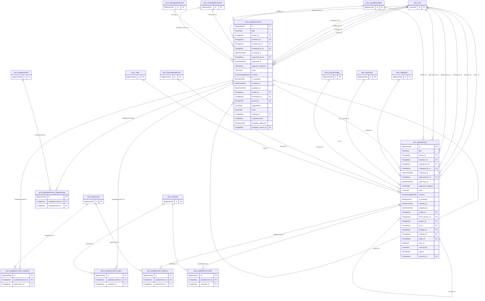

## RA 실무 2: 품질시스템 밸리데이션

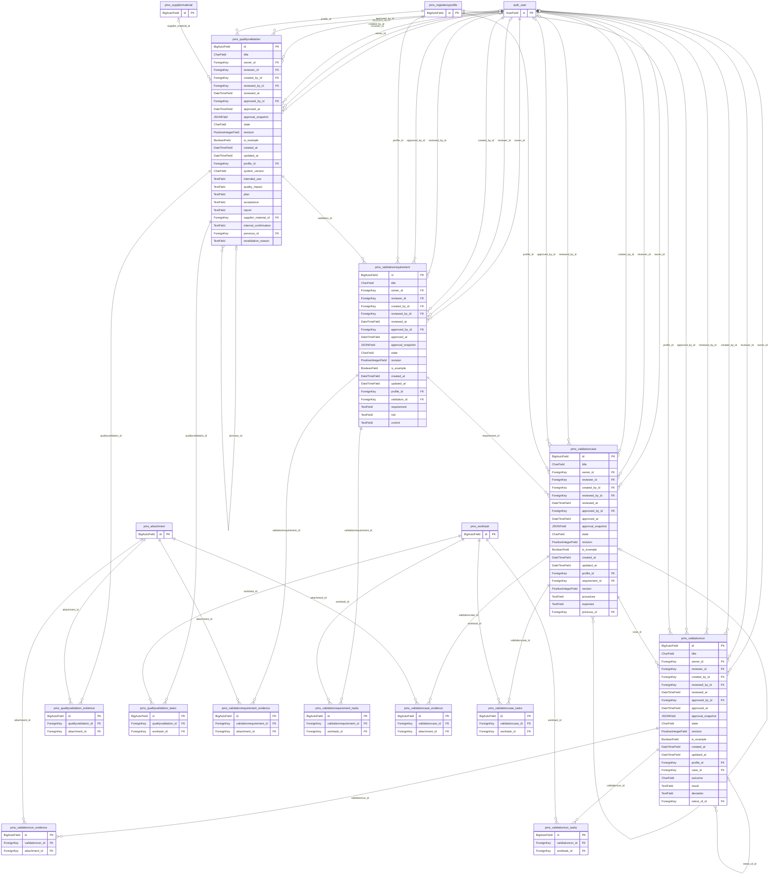

## RA 실무 3: 회의록 후보·DHF

```mermaid
erDiagram
    pms_dhfproject {
        BigAutoField id PK
        CharField title
        ForeignKey owner_id FK
        ForeignKey reviewer_id FK
        ForeignKey created_by_id FK
        ForeignKey reviewed_by_id FK
        DateTimeField reviewed_at
        ForeignKey approved_by_id FK
        DateTimeField approved_at
        JSONField approval_snapshot
        CharField state
        PositiveIntegerField revision
        BooleanField is_example
        DateTimeField created_at
        DateTimeField updated_at
        ForeignKey profile_id FK
        ForeignKey release_id FK
        TextField purpose
    }
    pms_meetingsource {
        BigAutoField id PK
        CharField title
        ForeignKey owner_id FK
        ForeignKey reviewer_id FK
        ForeignKey created_by_id FK
        ForeignKey reviewed_by_id FK
        DateTimeField reviewed_at
        ForeignKey approved_by_id FK
        DateTimeField approved_at
        JSONField approval_snapshot
        CharField state
        PositiveIntegerField revision
        BooleanField is_example
        DateTimeField created_at
        DateTimeField updated_at
        ForeignKey profile_id FK
        ForeignKey project_id FK
        ForeignKey minutes_id FK
        DateField meeting_on
    }
    pms_meetingcandidate {
        BigAutoField id PK
        CharField title
        ForeignKey owner_id FK
        ForeignKey reviewer_id FK
        ForeignKey created_by_id FK
        ForeignKey reviewed_by_id FK
        DateTimeField reviewed_at
        ForeignKey approved_by_id FK
        DateTimeField approved_at
        JSONField approval_snapshot
        CharField state
        PositiveIntegerField revision
        BooleanField is_example
        DateTimeField created_at
        DateTimeField updated_at
        ForeignKey profile_id FK
        ForeignKey meeting_id FK
        PositiveIntegerField line_number
        TextField excerpt
        CharField category
        ForeignKey document_id FK
        ForeignKey mentioned_file_id FK
        CharField suggested_owner
        CharField suggested_due
        TextField uncertainty
        ForeignKey confirmed_trace_id FK
    }
    pms_designtrace {
        BigAutoField id PK
        CharField title
        ForeignKey owner_id FK
        ForeignKey reviewer_id FK
        ForeignKey created_by_id FK
        ForeignKey reviewed_by_id FK
        DateTimeField reviewed_at
        ForeignKey approved_by_id FK
        DateTimeField approved_at
        JSONField approval_snapshot
        CharField state
        PositiveIntegerField revision
        BooleanField is_example
        DateTimeField created_at
        DateTimeField updated_at
        ForeignKey profile_id FK
        ForeignKey project_id FK
        ForeignKey requirement_id FK
        ForeignKey output_id FK
        ForeignKey risk_id FK
        ForeignKey verification_id FK
        ForeignKey change_id FK
        ForeignKey release_review_id FK
    }
    pms_dhfbaseline {
        BigAutoField id PK
        CharField title
        ForeignKey owner_id FK
        ForeignKey reviewer_id FK
        ForeignKey created_by_id FK
        ForeignKey reviewed_by_id FK
        DateTimeField reviewed_at
        ForeignKey approved_by_id FK
        DateTimeField approved_at
        JSONField approval_snapshot
        CharField state
        PositiveIntegerField revision
        BooleanField is_example
        DateTimeField created_at
        DateTimeField updated_at
        ForeignKey profile_id FK
        ForeignKey project_id FK
        JSONField baseline
    }
    pms_dhfproject_evidence {
        BigAutoField id PK
        ForeignKey dhfproject_id FK
        ForeignKey attachment_id FK
    }
    pms_dhfproject_tasks {
        BigAutoField id PK
        ForeignKey dhfproject_id FK
        ForeignKey worktask_id FK
    }
    pms_meetingsource_evidence {
        BigAutoField id PK
        ForeignKey meetingsource_id FK
        ForeignKey attachment_id FK
    }
    pms_meetingsource_tasks {
        BigAutoField id PK
        ForeignKey meetingsource_id FK
        ForeignKey worktask_id FK
    }
    pms_meetingcandidate_evidence {
        BigAutoField id PK
        ForeignKey meetingcandidate_id FK
        ForeignKey attachment_id FK
    }
    pms_meetingcandidate_tasks {
        BigAutoField id PK
        ForeignKey meetingcandidate_id FK
        ForeignKey worktask_id FK
    }
    pms_designtrace_evidence {
        BigAutoField id PK
        ForeignKey designtrace_id FK
        ForeignKey attachment_id FK
    }
    pms_designtrace_tasks {
        BigAutoField id PK
        ForeignKey designtrace_id FK
        ForeignKey worktask_id FK
    }
    pms_dhfbaseline_evidence {
        BigAutoField id PK
        ForeignKey dhfbaseline_id FK
        ForeignKey attachment_id FK
    }
    pms_dhfbaseline_tasks {
        BigAutoField id PK
        ForeignKey dhfbaseline_id FK
        ForeignKey worktask_id FK
    }
    auth_user {
        AutoField id PK
    }
    pms_regulatoryprofile {
        BigAutoField id PK
    }
    pms_productrevision {
        BigAutoField id PK
    }
    pms_attachment {
        BigAutoField id PK
    }
    pms_controlleddocument {
        BigAutoField id PK
    }
    pms_rarequirement {
        BigAutoField id PK
    }
    pms_productrisk {
        BigAutoField id PK
    }
    pms_productchange {
        BigAutoField id PK
    }
    pms_worktask {
        BigAutoField id PK
    }
    auth_user ||--o{ pms_dhfproject : "owner_id"
    auth_user |o--o{ pms_dhfproject : "reviewer_id"
    auth_user ||--o{ pms_dhfproject : "created_by_id"
    auth_user |o--o{ pms_dhfproject : "reviewed_by_id"
    auth_user |o--o{ pms_dhfproject : "approved_by_id"
    pms_regulatoryprofile ||--o{ pms_dhfproject : "profile_id"
    pms_productrevision ||--o{ pms_dhfproject : "release_id"
    auth_user ||--o{ pms_meetingsource : "owner_id"
    auth_user |o--o{ pms_meetingsource : "reviewer_id"
    auth_user ||--o{ pms_meetingsource : "created_by_id"
    auth_user |o--o{ pms_meetingsource : "reviewed_by_id"
    auth_user |o--o{ pms_meetingsource : "approved_by_id"
    pms_regulatoryprofile ||--o{ pms_meetingsource : "profile_id"
    pms_dhfproject ||--o{ pms_meetingsource : "project_id"
    pms_attachment ||--o{ pms_meetingsource : "minutes_id"
    auth_user ||--o{ pms_meetingcandidate : "owner_id"
    auth_user |o--o{ pms_meetingcandidate : "reviewer_id"
    auth_user ||--o{ pms_meetingcandidate : "created_by_id"
    auth_user |o--o{ pms_meetingcandidate : "reviewed_by_id"
    auth_user |o--o{ pms_meetingcandidate : "approved_by_id"
    pms_regulatoryprofile ||--o{ pms_meetingcandidate : "profile_id"
    pms_meetingsource ||--o{ pms_meetingcandidate : "meeting_id"
    pms_controlleddocument |o--o{ pms_meetingcandidate : "document_id"
    pms_attachment |o--o{ pms_meetingcandidate : "mentioned_file_id"
    pms_designtrace |o--o{ pms_meetingcandidate : "confirmed_trace_id"
    auth_user ||--o{ pms_designtrace : "owner_id"
    auth_user |o--o{ pms_designtrace : "reviewer_id"
    auth_user ||--o{ pms_designtrace : "created_by_id"
    auth_user |o--o{ pms_designtrace : "reviewed_by_id"
    auth_user |o--o{ pms_designtrace : "approved_by_id"
    pms_regulatoryprofile ||--o{ pms_designtrace : "profile_id"
    pms_dhfproject ||--o{ pms_designtrace : "project_id"
    pms_rarequirement |o--o{ pms_designtrace : "requirement_id"
    pms_controlleddocument |o--o{ pms_designtrace : "output_id"
    pms_productrisk |o--o{ pms_designtrace : "risk_id"
    pms_controlleddocument |o--o{ pms_designtrace : "verification_id"
    pms_productchange |o--o{ pms_designtrace : "change_id"
    pms_productrevision |o--o{ pms_designtrace : "release_review_id"
    auth_user ||--o{ pms_dhfbaseline : "owner_id"
    auth_user |o--o{ pms_dhfbaseline : "reviewer_id"
    auth_user ||--o{ pms_dhfbaseline : "created_by_id"
    auth_user |o--o{ pms_dhfbaseline : "reviewed_by_id"
    auth_user |o--o{ pms_dhfbaseline : "approved_by_id"
    pms_regulatoryprofile ||--o{ pms_dhfbaseline : "profile_id"
    pms_dhfproject ||--o{ pms_dhfbaseline : "project_id"
    pms_dhfproject ||--o{ pms_dhfproject_evidence : "dhfproject_id"
    pms_attachment ||--o{ pms_dhfproject_evidence : "attachment_id"
    pms_dhfproject ||--o{ pms_dhfproject_tasks : "dhfproject_id"
    pms_worktask ||--o{ pms_dhfproject_tasks : "worktask_id"
    pms_meetingsource ||--o{ pms_meetingsource_evidence : "meetingsource_id"
    pms_attachment ||--o{ pms_meetingsource_evidence : "attachment_id"
    pms_meetingsource ||--o{ pms_meetingsource_tasks : "meetingsource_id"
    pms_worktask ||--o{ pms_meetingsource_tasks : "worktask_id"
    pms_meetingcandidate ||--o{ pms_meetingcandidate_evidence : "meetingcandidate_id"
    pms_attachment ||--o{ pms_meetingcandidate_evidence : "attachment_id"
    pms_meetingcandidate ||--o{ pms_meetingcandidate_tasks : "meetingcandidate_id"
    pms_worktask ||--o{ pms_meetingcandidate_tasks : "worktask_id"
    pms_designtrace ||--o{ pms_designtrace_evidence : "designtrace_id"
    pms_attachment ||--o{ pms_designtrace_evidence : "attachment_id"
    pms_designtrace ||--o{ pms_designtrace_tasks : "designtrace_id"
    pms_worktask ||--o{ pms_designtrace_tasks : "worktask_id"
    pms_dhfbaseline ||--o{ pms_dhfbaseline_evidence : "dhfbaseline_id"
    pms_attachment ||--o{ pms_dhfbaseline_evidence : "attachment_id"
    pms_dhfbaseline ||--o{ pms_dhfbaseline_tasks : "dhfbaseline_id"
    pms_worktask ||--o{ pms_dhfbaseline_tasks : "worktask_id"
```

## RA 실무 4: 소프트웨어 변경심사

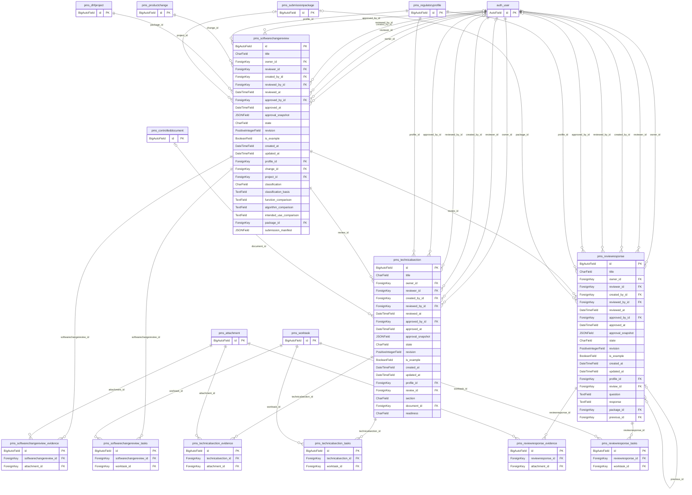

## RA 실무 5: 사이버보안

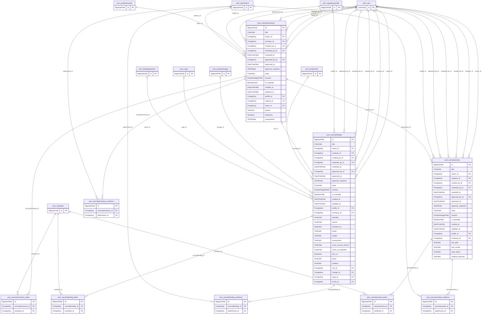
